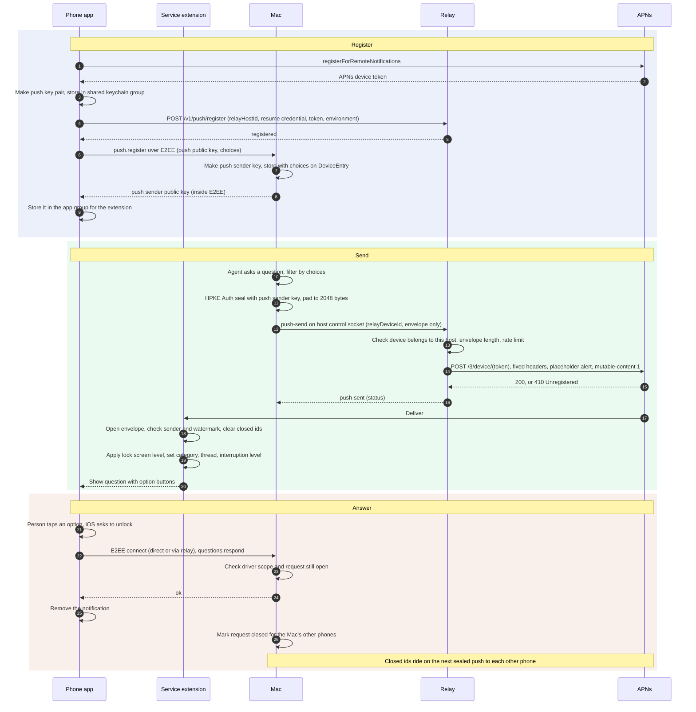

# End-to-end encrypted Apple push notifications

Part of the phone connection research (#989). This is a design, not shipped
code. It answers the push questions in #989 and builds on the notification
settings in #990 (Superdesign board 22.07, approved 2026-11-15).

## Summary

- The Mac encrypts every notification for the phone with HPKE. The relay
  passes the sealed bytes to Apple. A Notification Service Extension on the
  phone opens them and writes the real text. The relay and Apple only ever see
  a fixed placeholder ("TerminalX", "New activity on your Mac") and ciphertext
  of a fixed size.
- Every push looks the same on the wire, whatever the event: same headers,
  same size, same placeholder, no collapse id, no category, no thread id. The
  relay and Apple can see that a Mac sent a push to a phone at a given time.
  They cannot see which kind of event it was.
- The phone gets a new key pair for push only. Its private key is readable
  after first unlock, so the extension can use it on a locked phone. It is not
  the transport key, which stays readable only while the phone is unlocked.
- The Mac makes a separate push sender key per phone and seals with HPKE Auth
  mode, so the extension knows the push came from that Mac. The Mac's host key
  is not reused for push.
- The relay holds three things per registration: the Mac's relay host id, the
  phone's relay device id, and the APNs device token. It never holds keys,
  text, session or project names, or the phone's account.
- The phone registers its APNs token with the relay itself, using the relay
  credential it already has. This works for a phone paired by QR code without
  an account. It does not work for an "Only this network" pairing, which has no
  relay credential.
- The person's choices from #990 are kept on the Mac, per device, while push is
  on. The Mac filters before it sends. The phone applies the lock screen level.
- Approve, Deny and question options can be answered from the notification.
  The action asks iOS to unlock the phone first, then the app answers over the
  normal end-to-end encrypted connection. The relay holds nothing that could
  forge an answer.
- With data privacy mode on, the Mac sends nothing, and nothing is queued for
  later.

## What exists today

- The phone and the Mac run E2EE v2 over a direct or relay path. The relay
  "may see identities, relay/device ids, routing metadata, socket metadata,
  and plaintext E2EE handshake frames" and nothing inside
  ([ACCOUNTS.md](../ACCOUNTS.md), "Relay director and cell").
- The Mac's host key is a long-lived X25519 key in the macOS Keychain. The
  phone pins its public key from the pairing offer
  ([ACCOUNTS.md](../ACCOUNTS.md), "Host identity and account binding").
- HPKE `HPKE-Base-X25519-HKDF-SHA256-ChaCha20Poly1305` is already used for
  account pairing: the Mac seals in `src-tauri/src/pairing/crypto.rs`
  (`seal_account_offer`) and the phone opens in `mobile/src/pairing/hpke.ts`
  (`openAccountPairingEnvelope`).
- The phone's E2EE key (`mobile/src/transport/e2ee-keypair.ts`) and every other
  secret are stored with `WHEN_UNLOCKED_THIS_DEVICE_ONLY`.
- The Mac makes three notices today: turn finished, permission requested,
  question asked (`background_notice`, `src-tauri/src/local_runtime.rs:71`).
  The phone receives them only over its live connection
  (`notifications.subscribe`, `mobile/src/notifications/local.ts`).
- `expo-notifications` is in the plugin list in `mobile/app.json`, which adds
  the `aps-environment` entitlement. `mobile/app.config.js` removes it for
  builds signed with a free personal team.
- The relay server has no push endpoint today.

## Decisions

### 1. What the relay holds, and what it never sees

The relay holds, per registration:

| Field | Why |
| --- | --- |
| `relayHostId` | Which Mac may send to this phone. |
| `relayDeviceId` | Which paired phone of that Mac. The relay already stores it for the relay credential. |
| APNs device token | Where Apple delivers. |
| APNs environment (`development` or `production`) | Which APNs server to call. |
| Registered at, last sent at, send counters | Expiry and rate limits. |

The relay does not need the phone's account. A phone paired by QR code may
have none. The relay already knows which account owns the Mac, from the host
proof; push adds nothing to that.

The relay never sees: notification titles or text, question text or options,
permission reasons, transcripts, prompts, project, session, tab or worktree
names or ids, the event kind, the phone's push public key, the Mac's push
sender public key, any private key, the device token used for E2EE auth, or the
person's notification choices. Every push it forwards has the same headers and
the same envelope length, so it cannot tell kinds apart by shape either.

The Mac never learns the APNs device token. It names the phone by
`relayDeviceId`, which it already has.

### 2. Encrypting on the Mac, decrypting in the extension

**Keys.** On first use of push the phone makes a new X25519 key pair, the
*push key*. It is separate from the transport key for two reasons:

- The extension must read it on a locked phone. `WhenUnlockedThisDeviceOnly`
  data "can be accessed only while the device is unlocked by the user"
  ([kSecAttrAccessibleWhenUnlockedThisDeviceOnly](https://developer.apple.com/documentation/security/ksecattraccessiblewhenunlockedthisdeviceonly)).
  Most pushes arrive while the phone is locked.
- `AfterFirstUnlockThisDeviceOnly` data stays readable "until the next
  restart" after the first unlock, and is "recommended for items that need to
  be accessed by background applications"
  ([kSecAttrAccessibleAfterFirstUnlockThisDeviceOnly](https://developer.apple.com/documentation/security/ksecattraccessibleafterfirstunlockthisdeviceonly)).
  Lowering the transport key to that level would weaken the live connection.
  A separate key limits the loss to notification text.

The push private key is stored with `AfterFirstUnlockThisDeviceOnly` in a
keychain access group shared by the app and the extension. Apple: "Any app in a
given group can share keychain items with all the other apps in the same
group", set with the `keychain-access-groups` entitlement and prefixed with the
team id
([Sharing access to keychain items](https://developer.apple.com/documentation/security/sharing-access-to-keychain-items-among-a-collection-of-apps)).
With a `ThisDeviceOnly` class the item stays on this device and does not move to a new one
([kSecAttrAccessibleAfterFirstUnlockThisDeviceOnly](https://developer.apple.com/documentation/security/ksecattraccessibleafterfirstunlockthisdeviceonly)).

A small local Expo module (like `mobile/modules/paste-image`) creates and
writes the key from Swift, so the app and the extension use the same keychain
query. `expo-secure-store` also has an iOS `accessGroup` option, but its
internal item naming would then have to be copied into the extension.

**Sealing.** The phone sends its push public key to each Mac inside E2EE
(`push.register`, below). The Mac seals each notification with HPKE in
**Auth** mode, with the same suite as account pairing (X25519, HKDF-SHA256,
ChaCha20-Poly1305). Auth mode needs a sender static key, and proves the push
came from the holder of it. Base mode, as used for account pairing, would let
anyone who learned the push public key forge a notification.

The sender static key is a new X25519 key, the *push sender key*, one per
paired phone. The Mac makes it on the first `push.register` from that phone,
keeps the private key in the macOS Keychain next to the device's credential,
and returns the public key in the `push.register` result, inside E2EE. The
phone stores that public key in the app group, keyed by `relayHostId`. It is
not the Mac's host key, for two reasons:

- The host key already serves the E2EE handshake. Using one static key in two
  protocols is a known source of cross-protocol attacks. A separate key keeps
  push out of the transport's security argument.
- A push sender key can be rotated or deleted for one phone without touching
  the pairing.

The trust comes from the channel: the public key arrives over the E2EE
connection that is already bound to the pinned host key, so the relay cannot
swap it.

- Rust: the `hpke` crate used by `crypto.rs` has an Auth mode
  (`OpModeS::Auth`). Same code shape as `seal_account_offer`.
- Extension: CryptoKit has HPKE with this exact suite
  ([HPKE.Ciphersuite.Curve25519_SHA256_ChachaPoly](https://developer.apple.com/documentation/cryptokit/hpke/ciphersuite/curve25519_sha256_chachapoly))
  and an Auth mode recipient,
  `HPKE.Recipient.init(privateKey:ciphersuite:info:encapsulatedKey:authenticatedBy:)`,
  which "Creates a recipient in authentication mode", available from iOS 17.0
  ([HPKE.Recipient](https://developer.apple.com/documentation/cryptokit/hpke/recipient)).
  On iOS 16 the extension cannot open the payload and the placeholder shows.
- The TypeScript opener in `hpke.ts` is Base mode only. The app itself does not
  need to open pushes; only the extension does. The existing code is reused for
  the suite and the Rust sealing shape, not for the opener.
- `info` = `"terminalx-push.v1"` + `0x00` + `relayHostId` + `0x00` +
  `relayDeviceId`. A push sealed for one phone cannot be opened as a push for
  another.

**Plaintext** (JSON, before sealing):

```json
{
  "v": 1,
  "hostId": "derived-host-id",
  "epoch": "notification-epoch",
  "seq": 42,
  "kind": "question",
  "title": "Session title",
  "body": "Question text",
  "sessionId": "public-session-id",
  "tabId": "public-tab-id",
  "requestId": "pending-request-id",
  "options": [{ "id": "opt-1", "label": "Stacked" }, { "id": "opt-2", "label": "Inline" }],
  "closed": ["earlier-request-id"],
  "sentAt": 1763200000,
  "pad": "..."
}
```

`seq`, `epoch`, `title`, `body`, `sessionId` and `tabId` are today's
`HostNotification` fields. `kind` is #990's kind. `requestId` and `options`
are only for answerable kinds. `closed` lists up to eight earlier question or
approval request ids for this phone that were answered or withdrawn since the
last push (see "Stale questions"). `pad` fills the plaintext to exactly 2048
bytes, so the size never tells the relay or Apple how long the text is, or
whether options or `closed` ids are present. The Mac cuts `body` short to fit.

**Size.** Apple: "For all other remote notifications, the maximum payload size
is 4 KB (4096 bytes)"
([Generating a remote notification](https://developer.apple.com/documentation/usernotifications/generating-a-remote-notification)).
Sealed: 32 bytes encapsulated key + 2048 + 16 byte tag = 2096 bytes, 2795
characters in base64url. With the placeholder `aps` block the payload is about
2.95 KB.

**The payload the relay sends to Apple**, as an HTTP/2 `POST /3/device/<token>`
([Sending notification requests to APNs](https://developer.apple.com/documentation/usernotifications/sending-notification-requests-to-apns)):

```json
{
  "aps": {
    "alert": { "title": "TerminalX", "body": "New activity on your Mac" },
    "mutable-content": 1,
    "sound": "default"
  },
  "tx": { "v": 1, "e": "base64url sealed envelope" }
}
```

The payload does not name the Mac. Apple sees only the token, so it cannot tell
which of the person's Macs sent a push. No `category`, `thread-id` or `interruption-level` in `aps`: each would tell
Apple and the relay the event kind or the session. The extension sets
`categoryIdentifier`, `threadIdentifier` and `interruptionLevel` on the
content it returns.

**One shape for every push.** Anything that differs between events would tell
the relay and Apple the kind. So every push has exactly the same outside:

| Part | Value for every push |
| --- | --- |
| `apns-push-type` | `alert`, the type for a push that shows an alert ([Sending notification requests to APNs](https://developer.apple.com/documentation/usernotifications/sending-notification-requests-to-apns)). |
| `apns-priority` | `10`. Apple: "Specify 10 to send the notification immediately" ([Sending notification requests to APNs](https://developer.apple.com/documentation/usernotifications/sending-notification-requests-to-apns)). |
| `apns-expiration` | Now plus 24 hours, set by the relay. The Mac cannot choose it. Apple: "If the value is nonzero, APNs stores the notification and tries to deliver it at least once" ([Sending notification requests to APNs](https://developer.apple.com/documentation/usernotifications/sending-notification-requests-to-apns)). |
| `apns-collapse-id` | Never set. A collapse id on some pushes only, or one reused by a later push, would mark those pushes as questions or approvals. |
| `apns-topic` | The bundle id ([Sending notification requests to APNs](https://developer.apple.com/documentation/usernotifications/sending-notification-requests-to-apns)). |
| `aps` | The placeholder block above. |
| `tx.e` | Exactly 2795 base64url characters. |

The relay builds all of this itself (see "Relay API"). The Mac sends only the
device id and the envelope, so it has no field through which a kind could
leak.

**The extension.** It runs only when two conditions hold: "The payload must
include the `mutable-content` key with a value of `1`" and "The payload must
include an `alert` dictionary with title, subtitle, or body information"
([Modifying content in newly delivered notifications](https://developer.apple.com/documentation/usernotifications/modifying-content-in-newly-delivered-notifications)).
Apple also says the extension can "only operate on remote notifications configured in the system to display an alert to the user" (same page), so it does not run if alerts are off for the app.

Steps in `didReceive(_:withContentHandler:)`:

1. Read the push private key from the shared keychain group, and the push
   sender public key of each paired Mac from the app group.
2. Open the envelope with HPKE Auth, trying each Mac's sender key in turn
   (with that Mac's `info`). A phone has few Macs, and a wrong key fails the
   AEAD check at once. Check `hostId` in the plaintext matches the key that
   opened it.
3. Check `(epoch, seq)` is newer than the watermark for that host in the app
   group. A replay or an older one shows the placeholder.
4. Remove any shown notification whose request id is in `closed` (see "Stale
   questions").
5. Apply the lock screen level from #990, read from the app group:
   *Everything* shows title and body and sets the category (action buttons);
   *Session name only* shows the session name, no body, no category;
   *Nothing* keeps the placeholder text and no category.
6. Set `threadIdentifier` to the session id, `interruptionLevel` to
   `.timeSensitive` for question and approval and `.active` otherwise, and put
   `sessionId`, `tabId`, `requestId` in `userInfo` so a tap opens the tab.
7. Write the new watermark and call the content handler.

**Limits.** "Your `didReceive(_:withContentHandler:)` method has only about 30
seconds to modify the payload and call the provided completion handler. If
your code takes longer than that, the system calls the
`serviceExtensionTimeWillExpire()` method"
([Modifying content in newly delivered notifications](https://developer.apple.com/documentation/usernotifications/modifying-content-in-newly-delivered-notifications)).
The work above is one keychain read, one X25519 operation and one AEAD open:
milliseconds, no network. On timeout the extension returns the placeholder.

Apple does not publish a memory figure for this extension. It says "Memory
limits for running app extensions are significantly lower than the memory
limits imposed on a foreground app"
([App Extension Programming Guide, Creating an App Extension](https://developer.apple.com/library/archive/documentation/General/Conceptual/ExtensibilityPG/ExtensionCreation.html)).
So the extension is plain Swift with CryptoKit and Security only. No React
Native, no JavaScript runtime, no network.

**Dropping a notification.** Without an extra entitlement the extension cannot
hide a push; it can only change the text. With
`com.apple.developer.usernotifications.filtering`, "after you receive
permission to use the entitlement", the extension can "silence push
notifications after your extension receives them" by returning empty content
([Filtering entitlement](https://developer.apple.com/documentation/bundleresources/entitlements/com.apple.developer.usernotifications.filtering)).
Apple also says "you must set the apns-push-type header field to alert" for
such pushes, which every push here already does. Recommendation: ask Apple for
it, to drop replays and to hold pushes in quiet hours on the phone. The design works
without it: a replay shows the placeholder, and stale notifications are
cleared on the next push or when the app opens.

**Stale questions.** A question or approval may be answered on the Mac or on
another phone while its notification is still shown. APNs could replace it
with a second push that carries the same `apns-collapse-id`, but that would
show the relay and Apple which pushes were answerable and when they were
answered. So the design does not use collapse ids, and clears stale
notifications from inside the encryption instead:

- The Mac keeps, per phone, the request ids it pushed that are now closed. It
  puts up to eight of them in `closed` on the next push to that phone, which
  is sealed and padded like any other.
- The extension removes those from Notification Center before it returns, with
  `removeDeliveredNotifications(withIdentifiers:)`, which "Removes your app's
  notifications from Notification Center that match the specified identifiers"
  ([removeDeliveredNotifications(withIdentifiers:)](https://developer.apple.com/documentation/usernotifications/unusernotificationcenter/removedeliverednotifications(withidentifiers:))).
  The notification's identifier is the request id, set by the extension. Apple
  does not say whether an extension may call this method; follow-up 6 tests it
  on a device.
- When the app comes to the foreground it asks each Mac which pushed requests
  are still open and removes the rest.
- There is no separate push that only clears stale notifications, even with
  the filtering entitlement. Such a push would follow the moment another phone
  or the Mac answered, and the relay could tell it apart by that timing.
- An action on a stale notification reaches the Mac, which refuses it as no
  longer open, as today. The app then removes the notification and posts
  nothing.

**Offline phone.** Apple: "APNs stores only one notification per bundle ID",
"In most cases, the latest notification is stored", and "APNs uses best
efforts to honor the expiry date without any guarantee"
([Sending notification requests to APNs](https://developer.apple.com/documentation/usernotifications/sending-notification-requests-to-apns)).
So push is a nudge, not a log. The relay sets `apns-expiration` to 24 hours
for every push. When the app opens it catches up with
`notifications.missedSince`, as today.

**Double alerts.** The phone tells the Mac when it goes to the background or
comes back (`device.appState`, below). The Mac sends over the live
subscription while the app is in the foreground, and pushes otherwise. Both
paths share the watermark in the app group (moved from AsyncStorage), so the
same `(epoch, seq)` is shown once.

### 3. Which events, and how the choices are kept

**Events.** The Mac pushes the kinds from #990:

| Kind | From | Answerable |
| --- | --- | --- |
| `question` | `QuestionsAsked` (exists) | Yes, options |
| `approval` | `PermissionRequested` (exists) | Yes, Allow or Deny |
| `finished` | `TurnCompleted` (exists) | No |
| `failed` | new in #990 (failed or stopped on an error) | No |
| `usage_limit` | new in #990 | No |
| `pr_checks_failed`, `pr_merged` | new in #990 | No |

Every kind is sent with the same outside shape. The kind is only inside the
sealed plaintext.

**Choices.** #990 says the Mac keeps no record of the choices beyond the live
subscription. That cannot hold for push: when the phone is suspended there is
no live subscription, and the Mac must still decide what to send. So:

- When push is on, the phone sends its choices to each Mac inside E2EE with
  `push.register`: the same kinds, session scope and per-session overrides that
  #990 sends with `notifications.subscribe`, plus quiet hours and the phone's
  time zone.
- The Mac stores them on the device's record (`DeviceEntry`,
  `src-tauri/src/pairing/model.rs`), with the push public key. It is local to
  the Mac, never sent to the relay, and deleted on revoke, on
  `push.unregister`, and when the phone turns push off for that machine.
- The phone sends them again whenever a choice changes and on every connect.
  The Mac keeps the last one.
- The Mac filters by kind, session scope, override and quiet hours before it
  seals anything. Nothing is sent for a filtered event, so the relay cannot
  even count it.
- The lock screen level stays on the phone (app group), applied by the
  extension.
- A machine switched off on the phone sends `push.unregister` to that Mac and
  `POST /v1/push/unregister` to the relay for that `relayHostId`. Either one is
  enough to stop pushes; both are sent so neither side keeps a stale record.

Quiet hours move to the Mac for push because the extension cannot hide a
notification without the filtering entitlement. If Apple grants it, quiet
hours can move back to the phone.

### 4. Answering from the notification

**What iOS offers.** "When the user selects an action, the system launches
your app in the background and calls the delegate's
`userNotificationCenter(_:didReceive:withCompletionHandler:)` method"
([Handling notifications and notification-related actions](https://developer.apple.com/documentation/usernotifications/handling-notifications-and-notification-related-actions)).
Actions are grouped in categories, which the app must declare "at launch time"
([Declaring your actionable notification types](https://developer.apple.com/documentation/usernotifications/declaring-your-actionable-notification-types)).
A text action lets "the user provide a custom text-based response"
([UNTextInputNotificationAction](https://developer.apple.com/documentation/usernotifications/untextinputnotificationaction)).

**Categories.**

- `tx.approval`: Allow, Deny. The Mac maps them to the request's own option ids
  and puts both ids in the sealed plaintext.
- `tx.question`: for a single question with up to four options, one button per
  option. Option labels change per question, while categories are declared at
  launch. The plan is for the extension to register a per-request category
  before returning; this is not documented by Apple and needs a device test
  (follow-up 6). The fallback is one "Answer in TerminalX" button with the
  `foreground` option, which "causes the app to launch in the foreground"
  ([foreground](https://developer.apple.com/documentation/usernotifications/unnotificationactionoptions/foreground)).
- `tx.question.text`: a single question that takes a free text answer gets a
  "Reply" `UNTextInputNotificationAction`. Its label does not change, so it can
  be declared at launch with the others. The typed text goes to the Mac only
  inside E2EE, as the `questions.respond` answer.
- A request with several questions or multi-select uses the fallback.

Which category the extension sets is decided inside the sealed plaintext, so
the relay and Apple never learn whether a push had buttons.

**Authentication.** Every answer action uses `authenticationRequired`: "The
action can be performed only on an unlocked device. When the user selects an
action with this option, the system prompts the user to unlock the device.
After unlocking, the system notifies your app of the selected action. You
might use option to perform actions that require accessing data that is
encrypted while the device is locked"
([authenticationRequired](https://developer.apple.com/documentation/usernotifications/unnotificationactionoptions/authenticationrequired)).

So:

1. The person taps Allow. iOS asks for Face ID or the passcode.
2. iOS starts the app in the background. The phone is unlocked, so the
   transport key, device token and relay credential (all
   `WhenUnlockedThisDeviceOnly`) are readable.
3. The app opens the usual E2EE connection (direct or relay) and calls the
   existing `permission.respond` or `questions.respond` with the session id,
   tab id and request id from `userInfo` (see [MOBILE.md](../MOBILE.md),
   "Terminal, steering, and permissions").
4. The Mac checks as today: device scope is driver, request is still pending,
   option id is valid. A request answered first elsewhere is refused.
5. On success the app removes the notification. On failure it posts a local
   notification: "Could not reach your Mac. Open TerminalX to answer."

What authenticates the answer: the E2EE channel bound to the pinned host key
and the phone's transport key, and the device token inside `e2ee_auth`. The
relay holds none of these. It cannot forge a push either: it does not hold the
Mac's push sender private key, so HPKE Auth fails and the extension shows the
placeholder with no buttons. A replayed push fails the watermark check. An
answer to an old request hits "no longer open" on the Mac. Neither push key
can answer anything: the phone's push key only opens notifications, and the
Mac's push sender key only seals them. Apple sees the notification response
only as an event inside the phone; the answer never passes through Apple.

Apple does not state how long the app may run in the background to handle the
action. The connect time is the part to measure (the cold-start numbers are in
the reconnect piece of #989). Whether Expo starts the JavaScript runtime for a
background action response also needs a test (follow-up 7).

With "Session name only" or "Nothing" on the lock screen, no category is set,
so there are no buttons, as #990 asks.

### 5. Apple and Expo requirements

| Need | Detail |
| --- | --- |
| Push capability | `aps-environment`, "development or production". "Xcode sets the value of the entitlement based on your app's current provisioning profile" ([aps-environment](https://developer.apple.com/documentation/bundleresources/entitlements/aps-environment)). `expo-notifications` already adds it; `app.config.js` already removes it for personal team builds. |
| APNs auth key (.p8) | Token-based auth. Use environment-specific team-scoped keys: "These keys restrict usage to either Sandbox or Production" and "Each environment can have a maximum of two keys". Refresh the JWT "no more than once every 20 minutes and no less than once every 60 minutes" ([Establishing a token-based connection to APNs](https://developer.apple.com/documentation/usernotifications/establishing-a-token-based-connection-to-apns)). |
| Where the key lives | Only in the relay service's secret store. Never in this repository, the app, a Mac or CI logs. The key id and team id are relay configuration, not committed. Rotation uses the second key slot, then revokes the old key. |
| APNs servers | `api.push.apple.com:443` and `api.sandbox.push.apple.com:443`, HTTP/2 ([Sending notification requests to APNs](https://developer.apple.com/documentation/usernotifications/sending-notification-requests-to-apns)). The phone tells the relay which one its token belongs to. |
| Dead tokens | 410 `Unregistered`: "There is no need to send further pushes to the same device token" ([Handling notification responses from APNs](https://developer.apple.com/documentation/usernotifications/handling-notification-responses-from-apns)). The relay deletes the registration. |
| Extension target | Notification Service Extension, bundle id `com.terminalx.next.mobile.NotificationService`. `NSExtensionPointIdentifier` is `com.apple.usernotifications.service` ([UNNotificationServiceExtension](https://developer.apple.com/documentation/usernotifications/unnotificationserviceextension)). Deployment target iOS 17.0 for CryptoKit HPKE. |
| Keychain sharing | `keychain-access-groups` on the app and the extension, one shared group, team prefixed ([Sharing access to keychain items](https://developer.apple.com/documentation/security/sharing-access-to-keychain-items-among-a-collection-of-apps)). |
| App group | `com.apple.security.application-groups` on both, for the watermark, the lock screen level and each Mac's push sender public key. "App groups that you register in your Apple Developer profile also act as keychain access groups" ([App Groups entitlement](https://developer.apple.com/documentation/bundleresources/entitlements/com.apple.security.application-groups)). |
| Filtering (optional) | `com.apple.developer.usernotifications.filtering`, requested from Apple (section 2). |
| Time sensitive | `interruptionLevel` `timeSensitive` "can break through system controls such as Notification Summary and Focus. The user can turn off the ability for time sensitive notification interruptions" ([timeSensitive](https://developer.apple.com/documentation/usernotifications/unnotificationinterruptionlevel/timesensitive)). Enable the Time Sensitive Notifications capability (`com.apple.developer.usernotifications.time-sensitive`; Apple's entitlement page for that key returned 404 when this was written, see "Open points"). Not `critical`, which "requires an approved entitlement" ([critical](https://developer.apple.com/documentation/usernotifications/unnotificationinterruptionlevel/critical)). |
| Device token | `getDevicePushTokenAsync()`, which "Returns a native FCM, APNs token". Not `getExpoPushTokenAsync()`, which routes through "Expo's push notifications service", a third party that would also see the token ([Expo Notifications](https://docs.expo.dev/versions/latest/sdk/notifications/)). |
| Expo prebuild | `ios/` is generated and not committed, so the extension target, its Swift sources, entitlements and the shared groups come from a local config plugin run by prebuild. EAS must know the extension "before the build starts" to generate its credentials: `extra.eas.build.experimental.ios.appExtensions` ([Expo app extensions](https://docs.expo.dev/build-reference/app-extensions/)). The personal team variant in `app.config.js` skips the extension and the groups. |

**App Store review notes.** Guideline 4.5.4: "Push Notifications must not be
required for the app to function, and should not be used to send sensitive
personal or confidential information"
([App Review Guidelines](https://developer.apple.com/app-store/review/guidelines/)).
Notes for the reviewer:

- Push is optional. It is off until the person turns on Allow notifications,
  and the app works fully without it.
- Notification text is end-to-end encrypted from the person's own Mac. Apple
  and our servers see only "TerminalX / New activity on your Mac". The
  extension decrypts it on the device.
- No marketing or promotional pushes are sent.
- The reviewer needs a paired Mac to see a real push. Provide a demo video and
  a test Mac setup in the review notes.

### 6. Phone paired by QR code without an account

Push depends on the relay credential, not on an account.

- **QR code, TerminalX Relay mode.** The Mac is signed in (relay mode
  "requires sign-in", [ACCOUNTS.md](../ACCOUNTS.md)). The phone need not be. The
  phone has a relay credential, so it can register its token and receive push.
  Signing the phone out of an account leaves QR pairings and their push in
  place.
- **Automatic (account) pairing.** Same path. Signing out removes the pairing,
  the Mac revokes the relay device, and the relay deletes the registration.
- **QR code, "Only this network".** No relay credential and no relay
  connection, so no push. The Notifications page says, for that machine:
  "Alerts while TerminalX is closed need TerminalX Relay." The live
  subscription still works while the app is open.
- **Mac signed out later.** The Mac has no relay control socket, so it cannot
  push. Registrations stay on the relay until revoked or unused for 30 days.

### 7. Data privacy mode

With data privacy mode on, the Mac sends nothing: no `push-send`, no relay
traffic at all, as relay streams are already off in that mode
([DATA-PRIVACY.md](../DATA-PRIVACY.md)). Events in that time are not queued
for later push, so turning the mode off does not flood the phone. The Mac keeps
the device's push record, so push resumes when the mode is turned off. The
phone's registration on the relay stays, but nothing is sent to it. The phone
learns nothing new about the Mac while the mode is on. When the app is opened
and connects again it sees the missed notices with `notifications.missedSince`,
as today.

## Who can see what

Terms used in the table:

- **Content**: title, body, question text and options, permission reason,
  error text, pull request title or number, and session, tab, project and
  worktree names and ids.
- **Sealed push**: what every push looks like outside the encryption. The relay
  sees the time, `relayHostId`, `relayDeviceId` and a 2795 character
  ciphertext. Apple sees the time, the device token, the bundle id, the fixed
  headers, the placeholder "TerminalX / New activity on your Mac" and the same
  ciphertext. Neither sees the kind, the content or the lock screen level. No
  push has a collapse id, category or thread id, so no field differs between
  kinds.

| Event | Phone | Mac | Relay | Apple |
| --- | --- | --- | --- | --- |
| Register | Its APNs token, its push key pair, its choices, the Mac's push sender public key | Phone's push public key and choices (inside E2EE); makes the push sender key; never the APNs token | APNs token, environment, `relayHostId`, `relayDeviceId`; not either push key or the choices | Token and bundle id, as for any app; not which Mac |
| `question` | Content and options after decrypting, as the lock screen level allows | All of it (it made it) | Sealed push | Sealed push |
| `approval` | Content, Allow and Deny, as the lock screen level allows | All of it | Sealed push | Sealed push |
| `finished` | Session name and summary, as the lock screen level allows | All of it | Sealed push | Sealed push |
| `failed` | Session name and error summary, as the lock screen level allows | All of it | Sealed push | Sealed push |
| `usage_limit` | Session name and which limit, as the lock screen level allows | All of it | Sealed push | Sealed push |
| `pr_checks_failed` | Session name, pull request and failed check, as the lock screen level allows | All of it | Sealed push | Sealed push |
| `pr_merged` | Session name and pull request, as the lock screen level allows | All of it | Sealed push | Sealed push |
| `closed` ids carried on a later push | Which earlier requests were closed; removes those notifications | All of it | Nothing beyond that push, which is a sealed push | Nothing beyond that push, which is a sealed push |
| Answer from notification (button or text) | The answer | The answer, checked as today | Encrypted E2EE frames and connection metadata, as for any phone connection; not the answer or which request | Nothing; the answer does not pass through Apple |
| Tap to open | Opens the session and tab | The app's usual requests | Encrypted E2EE frames, as for any phone connection | Nothing |
| Push key rotation | New push key pair | New phone push public key (inside E2EE) | Nothing | Nothing |
| Filtered out by a choice (kind, session, machine, quiet hours) | Nothing | The event | Nothing | Nothing |
| Privacy mode on | Nothing | The event | Nothing; the Mac's relay socket is closed, as for a Mac that is offline | Nothing |
| "Only this network" pairing | Live notices only while the app is open | All of it | Nothing (no relay use) | Nothing |
| Unregister, machine switched off, or revoke | Its choice | Push record and push sender key deleted | Registration deleted | Nothing new |

What the relay and Apple can still learn is metadata. They can see that a Mac
sent a push to a phone at a given time, and how many pushes a phone gets. The
relay can see that the phone connected soon after a push, which tells it the
person acted on some notification, not which one or what they chose; opening
the app after any push looks the same. They cannot tell which kind of event a
push was, read any of its text, or learn a project or session name.

## Sequence



## Relay API

New relay endpoints. All strict schemas, version 1, unknown fields refused,
like the existing relay JSON.

**Phone, HTTPS.**

```
POST /v1/push/register
  { "v": 1, "relayHostId": "...", "resumeToken": "...",
    "apnsToken": "<hex>", "environment": "production" | "development" }
  -> 200 { "v": 1, "registered": true }
  -> 401 credential not current or grace; 429 with Retry-After
```

The relay checks the resume credential the same way `POST /v1/resolve` does,
finds the `relayDeviceId` it belongs to, and stores or replaces the
registration for `(relayHostId, relayDeviceId)`. The phone calls it on every
launch where the token or credential changed, since Apple asks apps to register
"each time your app launches"
([Registering your app with APNs](https://developer.apple.com/documentation/usernotifications/registering-your-app-with-apns)).

```
POST /v1/push/unregister
  { "v": 1, "relayHostId": "...", "resumeToken": "..." }
  -> 200 { "v": 1, "registered": false }
```

**Mac, host control socket.**

```
{ "type": "push-send", "reqId": "...", "relayDeviceId": "...",
  "envelope": "<base64url, exactly 2795 chars>" }
-> { "type": "push-sent", "reqId": "...",
     "status": "sent" | "not-registered" | "unregistered" | "rate-limited" }
```

The message has no other fields, and the relay refuses unknown ones. The relay
builds the whole APNs request itself, the same for every push: fixed
placeholder `aps`, `apns-push-type: alert`, `apns-priority: 10`,
`apns-expiration` now plus 24 hours, no `apns-collapse-id`, `apns-topic` the
bundle id. It refuses an envelope of any other length. The Mac cannot set any
header or `aps` field, so a Mac bug cannot leak text or the kind into what the
relay and Apple see. The relay logs only the time, ids and status, never the
envelope.

```
{ "type": "push-status", "reqId": "...", "relayDeviceId": "..." }
-> { "type": "push-status", "reqId": "...", "registered": true | false }
```

For the Mac's Devices list ("Push on" or "Push off").

**Existing commands.** `device-revoke` (host control socket) also deletes that
device's registration.
A 410 from Apple deletes it. Registrations unused for 30 days are deleted.

**Rate limit.** Per `(relayHostId, relayDeviceId)`, for example 60 pushes a
minute and 1,000 a day, answered with `rate-limited`. The numbers are
placeholders to set with the relay owners.

**New phone RPC to the Mac (inside E2EE).**

| Method | Params | Result |
| --- | --- | --- |
| `push.register` | `{ pushPublicKeyB64, choices }` (choices as in #990, plus quiet hours and time zone) | `{ ok: true, pushSenderPublicKeyB64 }` |
| `push.unregister` | `{}` | `{ ok: true }`; the Mac deletes the push record and the push sender key |
| `push.openRequests` | `{ requestIds }` (from shown notifications) | `{ open: [...] }`; the app removes the rest |
| `device.appState` | `{ state: "foreground" \| "background" }` | `{ ok: true }` |

The Mac announces `push: 1` in `sync.capabilities`. A Mac without it gets no
`push.register`, and the phone says push needs a newer TerminalX on that Mac.

## Follow-up issues

Sizes: S is a day or two, M up to a week, L more.

1. **Relay push endpoints** (L, relay server): register, unregister,
   `push-send`, `push-status`, APNs HTTP/2 client with token auth, .p8 in the
   secret store, 410 and expiry cleanup, rate limits.
2. **Mac push sender** (M): `push.register` and `push.unregister` RPCs, choices
   on `DeviceEntry`, filter, HPKE Auth seal with padding, `push-send` on the
   control socket, push sender key per phone in the Keychain, privacy mode
   gate, `closed` ids, `push.openRequests`, Devices list status.
3. **Notification Service Extension and config plugin** (M): Swift target,
   CryptoKit HPKE Auth opener with Rust test vectors, shared keychain group and
   app group, lock screen levels, watermark, EAS `appExtensions`.
4. **Phone push registration** (M): push key module, `getDevicePushTokenAsync`,
   relay register on launch, `push.register` per Mac, `device.appState`,
   watermark moved to the app group, "needs TerminalX Relay" state on the
   Notifications page.
5. **Answer from notification** (M, after #979 and #990 part 7): categories,
   `authenticationRequired` actions, background connect and respond, failure
   local notification.
6. **Spike: what the extension may do on a device** (S): can it register a
   category per request and is it shown in time; does iOS keep the
   `categoryIdentifier`, `threadIdentifier` and `interruptionLevel` it sets;
   can it call `removeDeliveredNotifications(withIdentifiers:)` for `closed`
   ids.
7. **Spike: background action handling in Expo** (S): does the JavaScript
   runtime start for a background action response, and how long it may run.
   Measure connect and answer time on Wi-Fi and mobile data.
8. **Request the filtering entitlement from Apple** (S, owner): then drop
   replays, and move quiet hours back to the
   phone.
9. **App Store submission notes** (S): reviewer notes above, demo video,
   check the export compliance answer now that an extension does encryption.
10. **Amend #990 for push** (S): with push on, the choices and quiet hours are
    kept on the Mac per device (section 3), which changes #990's "the Mac keeps
    no record of the choices beyond the live subscription".

## Open points

- Whether iOS honours a `categoryIdentifier`, `threadIdentifier` and
  `interruptionLevel` set by the extension, and whether the extension may
  remove delivered notifications, is not stated by Apple. Follow-up 6 tests it.
  If removal is refused, stale notifications are cleared when the app opens.
- The minimum iOS version of the app under Expo SDK 58 was not checked. Phones
  below iOS 17 get the placeholder only.
- Which Mac process sends the push (the desktop app or `terminalx-serve`)
  follows whichever holds the relay control socket.
- The Time Sensitive capability's entitlement page
  (`com.apple.developer.usernotifications.time-sensitive`) returned 404 when
  this was written; the level's behaviour is cited above. Check the key in
  Xcode's Signing and Capabilities when building follow-up 3.
