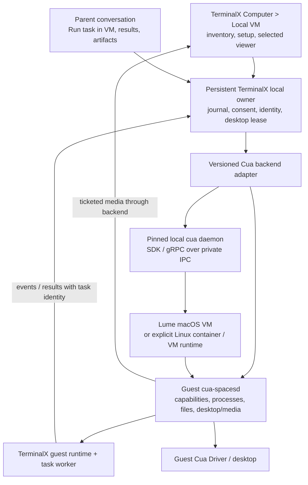

# Cua Spaces behind TerminalX Computer > Local VM

Research date: 2026-10-29, Asia/Dubai. **Decision: feasible with conditions.** Research and architecture recommendation only; no implementation, dependency adoption, installation, VM operation, or live acceptance was performed.

## Executive recommendation

Keep **TerminalX as the UI and task authority**. Integrate Cua through a small Rust backend adapter in TerminalX's persistent local owner, preferably using the released MIT SDK/client against a separately managed, pinned local `cua daemon`. Use Cua for environment lifecycle, image resolution, guest capabilities, desktop operations and—subject to licensing—media. Keep the existing Computer panel, add an appropriate stream surface, and retain PRO-114's parent/task identities, journals, results, scoped input transfer, consent and desktop ownership.

The separate Spaces app is **not required** for this architecture. Cua exposes SDK, CLI, gRPC/gRPC-Web and MCP interfaces independently of its app. However, a bare MIT SDK is **not the complete desktop stack**: `cua-spacesd`, decoded media implementations and viewers are FSL components. A commercial TerminalX product offering comparable local desktops needs an owner/legal determination or commercial agreement before their distribution or product integration. Calling an external executable does not settle that question. [SDK architecture][sdk-readme], [component licensing][licensing], [FSL terms][fsl], [commercial guidance][commercial]

Do **not** adopt the complete Spaces product or extend the restricted Lume fork as the default next step. First prove a narrow backend connection and panel stream on a disposable Linux guest, then separately validate a SIP-enabled macOS 26 provisioning profile. The latter remains a real blocker:

- Released Lume 0.6.1 does automate a fresh Tahoe account by editing the stopped guest's Data volume. It hardcodes an administrator `lume`, password `lume`, autologin, SSH, and disabled guest sleep/lock. This is useful upstream machinery to study, but it does not implement the desired personalized account and authenticated enrollment policy. [Released patcher][lume-patcher], [released create command][lume-create]
- The canonical Cua macOS 26 image requires **SIP disabled**, writes TCC grants and a capture-approval ledger during image building, and starts its preinstalled daemon at GUI login. This is not equivalent to guided human consent on a fresh SIP-enabled guest. The relevant image/launcher scripts are identical between Spaces 0.16.0 and the inspected main revision. [Image definition][mac-image], [TCC setup][seed-tcc], [image builder][mac-build]
- PRO-114's missing first trusted helper delivery is not supplied merely by opening a Cua socket, finding the VM IP, or receiving a token. Cua's prepared image trusts an already installed launcher and delivers an environment bearer through a share; a tokenless boot can accept `Init`. That is a different trust model, not evidence that the custom helper/account proof exists. [Guest launcher][mac-launcher], [Lume backend][vmm-lume]

**Practical outcome:** reuse substantially more upstream infrastructure, preserve TerminalX's product semantics, and stop treating the current custom bootstrap as the only possible architecture. Linux integration is the smallest useful experiment; seamless macOS 26 onboarding and commercial distribution remain conditional. Existing-VM enrollment can support evaluation, but cannot substitute for fresh-creation acceptance.

## 1. Scope, revisions and evidence discipline

**Verified source fact** means inspected source, documentation, API metadata or local files. It does not mean execution succeeded. **Inference/proposal** identifies an architectural conclusion. **Not tested** means no runtime evidence was obtained in this study.

### TerminalX baselines

| Item | Observed revision/state |
|---|---|
| This research checkout | `/Users/developer/code/ai/raccoon/.raccoon/worktrees/cua-spaces-local-vm-study`, branch `raccoon/cua-spaces-local-vm-study` |
| Actual research HEAD and locally recorded origin/main | `4159857eaf65fae87665f715c004feea8f6914e3`, merge of #654; this is the normal base inspected |
| PRO-114 author checkout | `/Users/developer/code/ai/raccoon/.raccoon/worktrees/pro-114-vm-foundation-continue` |
| Author checkpoint | `7536499c0b9d1097fb507f7a740e25892cbbe74e`, clean; source tree `a1f265709527d2381aeba6e458e758b8e43add9a` in current evidence |
| Common ancestor | `5a1c872376e7232692387b5dbc18c4238d6332e7`; the author's source is not this worktree's base |
| Author session/tab | `01a174e9-cd4a-7ae0-a6f5-e25dc49c7dfe` / `01a174e9-cd4a-7ae0-a6f5-e265fc1fd956`; TerminalX read-only tab discovery reported idle |
| Status evidence | `pro114-status.json`, updated 2026-10-28 20:46:04 UTC: acceptance and PR readiness false |
| Prepared artifact versus current source | Status retains older, unactivated `5689b35b` runtime/Dev artifacts. Those artifacts do not establish behavior of `7536499c` |
| Other issues | PRO-116 completed; PRO-117 queued. Neither was advanced |

The launch record in `watcher-status.json.authorizedResearchSession` names baseline `60d573fb8e48215b0bc4bd9e5e2302d4ae4a03b3`; direct Git inspection in this session reports `4159857e…`. This report uses the observed checkout, does not silently equate those records, and did not reset or merge anything.

Read: `/Users/developer/.codex/AGENTS.md`, the installed `terminalx skills get terminalx-cli` guide, applicable project instruction-file searches (no project AGENTS.md found), the five requested coordination inputs, and the author's four named documents plus relevant source. The research skill's delegation suggestion was superseded by the explicit single-researcher instruction. No worker/reviewer/session was created or contacted.

The coordination manifest's consolidation and current source status were read, not rewritten. STOP exists. Historical heartbeat retirement and the watcher's later scheduled-monitoring record describe different coordination history; neither was altered or used to start monitoring. Both retained VMs, including the comparison VM, and all six task histories were left untouched. VM state was not probed.

### Upstream snapshot

Main was resolved through GitHub's API to **`df2af4f410aa66e898e9e758bb63afda1bb33c55`**, committed **2026-10-28 21:31:32 UTC**. Upstream links below are pinned to that revision unless a release is explicitly identified. Public release metadata, PyPI/npm/crates.io metadata and four GHCR manifests were also read. No downloaded upstream code or installer was executed.

The hosted `cua.ai` quickstart pages did not resolve through the direct HTTP client during this study. Current official documentation was therefore read from the pinned repository's `docs/content/docs` sources, alongside implementation and release metadata. This avoids presenting a failed website fetch as a verified page. [Official SDK quickstart source][sdk-quickstart], [official Spaces quickstart source][spaces-quickstart]

## 2. What the components actually are

| Component | Role and integration relevance | Release/platform evidence and limits | License boundary |
|---|---|---|---|
| **Cua Spaces** | Complete desktop product: machine/Space catalog, onboarding, agent threads, sharing, teleport, Keyvault and stream UI. A Space may be a VM, container or existing physical computer; it does not inherently mean an isolated guest. | macOS SwiftUI app; shared web UI and Electron desktop packaging for Linux/Windows; Tauri app/core source also remains. The current quickstart supports macOS 26+, Ubuntu 24.04, Windows preview. Avoid the first-run host-computer enrollment path for this feature. | Apps and app core: FSL |
| **Lume** | Apple Virtualization.framework CLI/server for macOS and Linux VMs on Apple Silicon; restore, run, clone, SSH, native/VNC display and REST/MCP surfaces. Not a cross-platform host hypervisor. | Stable 0.6.1 macOS arm64 assets exist. Lume docs specify macOS 13+ host, but TerminalX's target remains macOS 26; OS/image/framework compatibility still needs validation. Linux hosts cannot run local macOS guests through Lume. | MIT source/release; Apple guest OS separately licensed |
| **Cua Driver** | Desktop automation on the machine where it runs: screenshots, accessibility, input, apps/windows/browser tools; CLI/MCP and typed SDKs. It does not provision a VM or move a coding agent. | macOS, Linux arm64/x64, Windows assets. 0.38.0 is published **with GitHub prerelease=true**. Platform/session/TCC constraints remain. Run it in the guest to avoid host control. | MIT core; optional perception/model artifacts have separate licenses |
| **cua SDK / CLI** | Rust runtime, Python/TypeScript bindings, sandbox/Space discovery and lifecycle, image/runtime preparation, clients for guest services. `Cua.embedded()` or `Cua.connect()`. | 0.9.0 confirmed on GitHub, PyPI, npm and crates.io. Browser bindings are a subset; Node native bindings are not directly loadable inside a Tauri webview. | MIT SDK and ordinary `cua-cli`; remote/extension features can require FSL services |
| **cua daemon** | Host-side SDK runtime shared by clients: sandboxes, connections, tunnels, registry, MCP, media bridge. Not the guest daemon. | Same SDK component/version. Owner-only UDS, or authenticated loopback. Can be used without the Spaces UI. Lifetime and shutdown policy must be owned explicitly. | MIT core; Spaces build registers FSL extensions |
| **cua-spacesd** | Guest-side processes/PTY, filesystem, Driver bridge, screenshots/input, streaming, presence, tickets and optional relay/teleport services. Replaces the older computer-server/rcdp service combination. | 0.8.0 assets include macOS arm64/x64 and universal app, Linux GNU/musl arm64/x64, Windows x64. macOS runs as a GUI-session LaunchAgent and needs stable permission identity. Protocol is not compatible with the former services. | FSL, including server/relay subtree |
| **cua-image / image tooling / cua-vmm** | OCI/catalog resolution, rootfs and VM disk variants, builds, runtime selection and provisioning. Linux can be a container or a real VM; macOS is Lume. | Canonical images have published digests; main includes more runtime/pool behavior than independently verified release behavior. Image readiness is not desktop or provider readiness. | Core tooling MIT; resulting images include OS, FSL daemon and third-party software |
| **Viewers/media** | HTML5 viewer, native viewer, codecs, transport/client and app integration. Independent from task execution. | HTML5 gRPC-Web + WebSocket, H.264/WebCodecs with raw/PNG handling; native decode/QUIC options. No drop-in noVNC protocol compatibility. | FSL implementations; general protobuf API remains MIT |

Evidence: [SDK crate map][sdk-readme], [Spaces core][spaces-core], [guest daemon][spacesd], [Driver][driver], [runtime selection][runtime-auto], [licensing inventory][licensing].

### Exact release map

Release existence proves distribution, not operational acceptance. Tags were resolved to commits instead of relying on the release's often-generic `target_commitish: main`.

| Component | Selected published version / date UTC | Exact tag commit | Observed artifacts |
|---|---|---|---|
| SDK/CLI | [0.9.0][release-sdk], Oct 24 | `cdf971573ef1343fcdeb29bdb814ed8d75c86993` | macOS arm64/x64; Linux arm64/x64 GNU; Windows arm64/x64; Python wheels, npm packages, proto archive, XCFramework |
| Spaces stable | [0.16.0][release-spaces], Oct 25 | `c90a42704331a6896b39b9a5412cbf64c395677c` | universal macOS DMG/PKG; Linux arm64/x64 AppImage/deb; Windows arm64/x64 installers |
| Spaces preview | [0.17.0-beta.10][release-spaces-beta], Oct 28 | `c40ef077d1482e87bd3c570d08aed9fda465505c` | beta desktop artifacts; not the stable selection |
| Guest daemon | [0.8.0][release-spacesd], Oct 24 | `38df3cd7c037ce9cea93149984c13ded83e9985e` | macOS app/binaries, Linux GNU/musl binaries, Windows x64 |
| Lume stable | [0.6.1][release-lume], Oct 4 | `3350f504014c85416009a90fcb339fe556ce02fc` | arm64 CLI/app and installer archives; also PRO-114 restricted-fork base |
| Lume nightly observed | [0.6.2-nightly.20261025.40163278849][release-lume-nightly], Oct 25 | `c9a8eadb93fb8215522c4716cbcfc9a014615f6a` | prerelease arm64 archives and release manifest; not automatically recommended |
| Driver tagged preview | [0.38.0][release-driver], Oct 21 | `85e2b1318bd77ccf3cfa88ccdf875a4bb7eaed19` | macOS/Linux/Windows assets; prerelease flag set |
| Driver latest nightly observed | `0.38.1-nightly.20261028.40632133438`, Oct 28 | `f06d538f7f743f063ee9312035874c489d9e63f6` in release metadata | nightly; not a proposed upgrade to the retained 0.28.0 profile |

Registry checks: [PyPI cua][pypi], [npm @trycua/cua][npm], [cua-sdk crate][crates-sdk], [cua-spacesd-client crate][crates-client] all reported 0.9.0. Rust is the natural TerminalX host integration choice. The README's “Swift not yet released” claim is too broad: the 0.9.0 release actually has `CuaSDKFFI.xcframework.zip`. A usable published SwiftPM integration and its compatibility were not validated; Kotlin publication was not established.

**Packaging trap:** the ordinary 0.9.0 release workflow builds MIT `cua-sdk` and `cua-cli`, but also bundles static Linux `cua-spacesd` binaries for injection into containers/microVMs. The Spaces app instead ships `cua-spaces-cli` under the same command name, `cua`. Neither an executable name nor MIT package metadata establishes that every file in its distribution is MIT. Review the exact archive bill of materials. [0.9.0 packaging workflow][sdk-release-workflow], [Spaces CLI manifest][spaces-cli]

### Documentation and release discrepancies

The root README still links Spaces 0.9.4 while release metadata shows stable 0.16.0. Its Swift-publication and streaming-license statements also conflict with the artifact/license evidence above and below. The current SDK built-in Lume source still pins 0.6.0, even though Lume 0.6.1 is published; selecting SDK 0.9.0 does not imply using Lume 0.6.1. [Built-in Lume source][lume-builtin]

This study compared selected release files with main: Lume 0.6.1's create/offline-account patcher and preset are unchanged; SDK 0.9.0's process protocol, SDK Cargo manifest, licensing document and HTML5 CSP are unchanged. Daemon server, Space service protocol, Lume adapter and CLI manifests have changed. Newer main-only lifecycle/isolation behavior therefore needs a version-specific compatibility check before use. This is not a claim that every main feature ships in the listed releases.

### Images: source catalog versus actual registry metadata

The following GHCR manifest reads downloaded metadata only. The returned `Docker-Content-Digest` matched a locally computed SHA-256 of each manifest body. Layers, image contents and doctor results were not executed or independently verified.

| Reference | Live manifest digest observed | Source catalog comparison |
|---|---|---|
| `ghcr.io/trycua/macos:26` | `sha256:7cb23670cad48a6723cf667bc63c444b83dc0c73756c23b614897127d5ba22ba` | Matches catalog and PRO-114's existing image pin; dated image `26-20261021-fca2193` |
| `ghcr.io/trycua/macos:26-slim` | `sha256:514003e5cbf652b1290745ed392a3777e150fe0a0a29a0a9869be2e7f10cd1d1` | Matches catalog; `26-slim-20261021-fca2193` |
| `ghcr.io/trycua/linux:24.04` | `sha256:f01a87c27929a6f4250cae18d8b46ab04d8a21c0abf5fef30c3cca463a23a1d0` | Catalog still says `sha256:9ac0d6f6f7dd95392554ec95163f83c5061de3db05b64977696c78d71cd4861c` |
| `ghcr.io/trycua/linux:24.04-disk` | `sha256:58546befb7467bf36c49377523aded3ca59758d8abb4d78099f7d7e7a97fac73` | Catalog still says `sha256:7e88db7b2ff3392d2b4c94fa0d2de4f3429b13eb4636b0717a85a7cc7ad13dcb` |

The Linux manifests identify revision `8fbdf83c1e05bf0a8b84a6199fe697cc58f0e24f` and link an upstream [doctor workflow run](https://github.com/trycua/cua/actions/runs/40450143477). Their annotation says pass; this study did not audit that run or equate it with TerminalX acceptance. Sources: [catalog][image-catalog], public [macOS manifest](https://ghcr.io/v2/trycua/macos/manifests/26), [slim manifest](https://ghcr.io/v2/trycua/macos/manifests/26-slim), [Linux manifest](https://ghcr.io/v2/trycua/linux/manifests/24.04), [Linux disk manifest](https://ghcr.io/v2/trycua/linux/manifests/24.04-disk). GHCR clients may require an anonymous pull token.

The source catalog records roughly 24.2 GB download / 34.9 GB unpacked for macOS full, and 23.6 GB / 33.9 GB for slim; both specify a 150 GiB virtual disk. Registry metadata reports 4 CPUs and 8 GiB memory. These are image metadata, not measured TerminalX usage. “Slim” is not a small macOS download. Linux rootfs versus disk needs an explicit UI distinction. The catalog's `26-xcode` entry is marked unpublished; Omarchy is amd64-only there, making Ubuntu arm64 a better first Linux choice on Apple Silicon. [Catalog][image-catalog]

## 3. Supported backend and viewer boundary

### Interfaces and ownership

| Boundary | Verified surface | TerminalX use / caveat |
|---|---|---|
| Host lifecycle | Rust `cua-sdk`, `cua-vmm`, `cua-sandbox-core`; CLI sandbox/runtime/image commands; daemon `cua.daemon.v1` | Put behind a versioned adapter. Select local placement and exact runtime explicitly. Default auto provisioning can download tools, start services or modify container runtime setup; discovery must not implicitly authorize that. |
| Host IPC | `~/.cua/cua.sock` mode 0600; native gRPC/gRPC-Web; loopback bearer and daemon metadata | Backend owns credentials. Do not expose the broad daemon token to React or agents. Standardize an isolated namespace/endpoint before adopting it; `CUA_HOME` alone is not proof all Lume settings/storage are isolated. |
| Guest API | `cua.env.v1` on 3211, `System.GetCapabilities`, processes, files, screenshots, windows, accessibility and Driver | Probe exact bound guest and capability limitations, then map them to TerminalX's readiness model. A serving health endpoint is insufficient. |
| Agent tools | Guest `/mcp`; sandbox-scoped `cua mcp --sandbox NAME`; Spaces tool filtering | Existing agent gets only the approved guest desktop/browser subset. Do not hand it fleet creation/deletion, host registration, teleport, arbitrary shell/files or other environments by default. |
| Media | `StreamService.OpenMedia`; ticketed WebSocket `/media`; optional QUIC UDP 3212 with certificate pinning | Prefer a backend-brokered WebSocket first. A native QUIC path requires a Rust/native bridge; browser JavaScript does not directly use this QUIC protocol. |
| Embedded viewer | Guest `/viewer/` or standalone viewer; viewer ticket, gRPC-Web, WebSocket | It is a reusable implementation, not a ready iframe: CSP sets `frame-ancestors 'none'`. Do not silently strip that protection. Use an approved embedded component/child webview design or a licensed media client. |
| Reconnect | Daemon connection, guest client reconnect/keepalive, new media tickets/keyframes, process output offsets | Reconnect transport and reconcile execution separately. Reconnection must never re-submit a task or blindly retry input. |
| Registration | Space IDs such as `local:<name>`, `direct:<host:port>`, registry/resolve/add/remove | Names/IPs locate a resource; TerminalX's environment ID and generation remain authoritative. Remove registration and delete underlying sandbox are different operations. |

Sources: [SDK][sdk-readme], [guest client][spacesd-client], [Spaces registry and MCP][spaces-core], [daemon server][daemon-server], [viewer source][html5], [media contract][media], [runtime selection][runtime-auto].

An independent `cua daemon` avoids making the Tauri window the owner of the backend. The guest daemon's LaunchAgent/systemd process owns guest services. Lume/QEMU/container runtime owns the machine. TerminalX's persistent local owner owns admissions, journals, power assertion and recovery; it should supervise or reconnect to the selected backend without creating a second competing lifecycle owner.

This is a **proposal**, not a guarantee that every upstream backend survives every daemon exit. Main's managed Linux runtime code includes explicit idle/shutdown behavior. The chosen runtime's daemon-exit, UI-exit and restart behavior must be tested separately. Avoid `Sandbox.ephemeral` for retained environments: its documented scope-exit cleanup is wrong for this product. [SDK quickstart][sdk-quickstart], [daemon local runtime][daemon-local]

### Native and webview limits

The current TerminalX `VncView.tsx` is a noVNC RFB client over `ws://127.0.0.1:<port>/websockify`. Cua's `/media` is a different protocol. Changing the URL cannot make that component decode Cua media.

Cua's HTML5 media session handles H.264 with WebCodecs and also raw BGRA/PNG paths. That does not establish that every server advertises a usable fallback or that TerminalX's WKWebView/WebKitGTK supports the chosen codec, secure context and audio APIs. Upstream's web app explicitly selects WebCodecs for its Electron shell and excludes the macOS native-video host. Its native macOS app uses a separate video surface. This is evidence to test TerminalX's exact webviews, not to require an OS upgrade. [Media session][html5-session], [web host selection][webcodecs-host], [native app][mac-app]

Start with read-only video, no audio/microphone/clipboard. The backend issues an expiring target-bound viewer capability. Input must pass TerminalX's shared desktop lease and human-takeover policy; a “view only” frontend toggle alone is insufficient enforcement. Full stock viewer tickets may expose more than pixels/input (for example files or terminal), so verify ticket policy and disable unused features. A disconnected or hidden view releases stream resources, not the task or VM.

If WebCodecs fails on macOS 26, evaluate a licensed Rust/native decoder surface or an advertised raw/PNG path before changing platforms. Keep the working Linux noVNC route while this is evaluated. Lume's native display is not itself an embeddable HTML component, and a localhost VNC URL does not prove its underlying listener is bound to loopback.

### Compare the four options

| Option | Value | Cost / risk | Recommendation |
|---|---|---|---|
| **SDK embedded in TerminalX's persistent Rust owner** | Typed APIs, fewer IPC hops; can use existing local-owner lifecycle | Large dependency surface, ABI/API churn, mixed optional functionality, cleanup behavior; never embed lifecycle in a transient webview | Good eventual choice once the needed release subset is established |
| **Adapter to separately managed Cua daemon** | App-independent API, isolates upgrades/failures, uses upstream provisioning and guest clients; no Spaces UI dependency | Must own version, endpoint, auth, startup and reconciliation; stock defaults touch shared Cua/Lume state; external process does not remove FSL obligations | **Preferred first boundary**, using SDK/protobuf clients rather than CLI text parsing |
| **Embed/fork entire Spaces product** | Maximum reuse of product onboarding, video, catalog and threads | Duplicates TerminalX sessions/UI, cloud/auth/Keyvault behaviors, platform shells and update lifecycle; FSL competing-use and packaging review; default onboarding controls host | Not currently advisable |
| **Continue current custom integration unchanged** | Keeps known task contracts and tailored controls; can stay with MIT Lume/Driver plus TerminalX runtime | Rebuilds provisioning, RPC, desktop packaging and stream functions; restricted fork remains blocked on first delivery; substantial maintenance | Preserve useful implementation, replace lower layers selectively; fallback if FSL use cannot be cleared |

## 4. Provisioning, first boot and the macOS 26 blocker

### What upstream solves—and what it does not

| Capability | Evidence available | Assessment for TerminalX |
|---|---|---|
| Image catalog, download/cache, disk variants, VM/container runtime choice | Catalog, image builder and runtime code; actual manifests exist | Strong reuse opportunity. Pin the chosen digest and runtime; tags and source catalog can differ. |
| Linux guest services | Canonical images include desktop, spacesd, init/service definitions and image doctor claims | Likely fastest useful integration. Linux rootfs/container is not a full guest kernel; offer VM disk explicitly when isolation requires it. |
| Fresh vanilla Tahoe OS/account | Released Lume offline patcher and headless SSH verification; README claims upstream Tahoe E2E | Source supports real automation, not just a README roadmap. This study did not reproduce it. Defaults are hardcoded and not the required secure personalized profile. |
| macOS desktop-ready prepared image | SIP-off base, daemon app + LaunchAgent, TCC/ReplayKit seeding, image/doctor/input gates | Explains “agent ready.” Does not satisfy SIP-preserving normal-consent onboarding. A build gate in source is not proof of every downloaded image or clone. |
| Per-instance daemon access | Setup-share bearer token, saved guest token; tokenless Init bootstrap; capabilities | Provides a practical trusted-image model. Does not attest a specific first helper/account, and tokenless bootstrap requires isolation review. |
| Agent setup | Installables, ACP harness/runner integration, detached runs/events, credentials support | Substantial optional reuse, but not needed for attached desktop tools. Keep guest-owned sign-in and do not enable automatic host credential forwarding. |
| Processes/files/input | Typed guest API, process request IDs and ledger, file transfers, Driver APIs | Reuse under TerminalX scope. Do not infer full task durability or desktop transaction ownership from per-call mechanisms. |
| Human approvals | Stable signed identities and normal macOS grant flow for generic installs; Spaces has its own onboarding/Keyvault approvals | Genuine OS/provider consent remains human-only. Preseeded image permissions are not equivalent to this flow. |
| Existing retained VMs | Address/Space registration and direct guest APIs, plus Lume lifecycle | Add a non-destructive adapter only after explicit later enrollment approval. Do not reimage, reseed permissions, change accounts or take ownership by name alone. |

Sources: [Lume stable patcher][lume-patcher], [stable unattended installer][lume-unattended], [macOS image build][mac-build], [daemon launcher][mac-launcher], [agent runs][agent-runs], [process protocol][process-proto], [image tooling][images-readme].

### Does Spaces resolve today's blocker?

**No, not under the current acceptance constraints.** It resolves a related problem by relying on a preconfigured image. It does not show a supported, credential-free, SIP-enabled fresh macOS 26 account/helper enrollment flow meeting this project's requirements.

The distinction matters:

1. **Vanilla Lume creation is not canonical Spaces image creation.** Lume can restore an Apple IPSW and edit its offline Data volume. The inspected stable patcher does not itself establish desktop TCC grants or install the Spaces guest service. Canonical image building adds those services and requires SIP-off permission seeding.
2. **The public patcher is not a personalized account API.** Its account/UID/password are constants. Passing a Tahoe preset/YAML does not establish configurable personalized account creation. The hardcoded Setup Assistant “last seen” value `26.5.2` is a marker, not proof of the actual restore OS/build. [Patcher][lume-patcher]
3. **The standard SSH path is weaker than PRO-114's pinned trust.** Released `SSHClient.swift` defaults to the shared `lume` account/password and its `AcceptAllHostKeysDelegate` accepts keys. Current SDK Lume guest execution still wraps `lume ssh`. That cannot silently replace the account-bound, strict-host-key transport requirement. [Released SSH client][lume-ssh], [SDK SSH adapter][vmm-ssh]
4. **A trustworthy image can simplify first delivery.** If a reviewed, signed and sanitized first-boot service is already in a verified image, the product can trust that provisioning chain and authenticate a per-instance service. It need not prove remote Unix PID/UID through VZ sockets. But the secure image preparation, unique secret delivery, account ownership and consent chain must be established first. This is an alternative architecture requiring review, not a trust downgrade inferred from a shared token.
5. **Do not assume macOS 27 is necessary.** Current upstream app/source targets include macOS 26. Whether a secure 26 provisioning route is supportable remains an investigation/live gate; this report neither requires an upgrade nor silently defers fresh creation.

For a future secure profile, first seek an upstream-supported path that provisions a user-selected account and signed guest service while preserving SIP and normal TCC approval. An Apple-IPSW local build plus supported service installation is preferable to redistributing a prepared macOS disk. If upstream cannot supply that, compare a bounded image-personalization contribution against the existing restricted fork. Manual guest Terminal commands may be diagnostic scaffolding only, not the final onboarding.

### Existing VMs and retained history

Keep the two existing environments on their present transport and generation. Adding a Cua backend is additive; no migration is required to retain the Linux noVNC route or the existing macOS task/runtime path.

A later adoption flow should inspect the exact provider identity, OS/account, daemon/Driver versions and capabilities, then offer explicit registration. Registering an existing service must not imply permission to restart, rotate credentials, edit TCC, install software or change its default account. A legacy computer-server guest may not support spacesd APIs; surface that limitation instead of silently upgrading it.

Store any new backend identifier alongside the TerminalX environment/generation. Preserve historical identity even when a provider resource disappears. Reject changed targets, reused names, incompatible protocols and missing history. Avoid auto-cleanup/warm-pool enrollment of retained VMs; the comparison VM remains outside the experiment. Keep the six histories and result/artifact references independent of Cua's registry or VM deletion.

## 5. Map to current TerminalX and PRO-114

### What actually exists on normal main

At `4159857e…`:

- [ComputerPanel.tsx](../../src/components/computer/ComputerPanel.tsx) provides Local/Cloud selection, Linux start/stop/reset, view-only versus control, and viewer reconnect.
- [VncView.tsx](../../src/components/computer/VncView.tsx) embeds noVNC.
- [src-tauri/src/local_vm.rs](../../src-tauri/src/local_vm.rs) manages one labeled Docker/Podman XFCE container, pinned to `docker.io/trycua/xfce-cua@sha256:274eb636f5cf3fc58f705916ee72b7a701270b3877369d08533a385c5325be9b`; viewer port 6901 is published on loopback. Cua Driver is invoked inside that container.
- The agent, its ordinary shell and project files remain on the host. A desktop attachment is not a guest worker. The current panel is therefore a useful UI foundation, not a macOS task implementation.

These links are relative to this report in the research checkout; use the recorded SHA when comparing later.

### Author branch seams and disposition

All paths in this table are in the **author checkout at `7536499c…`**, not necessarily on normal main.

| Real source seam | Current responsibility | Disposition with Cua adapter |
|---|---|---|
| `src-tauri/src/container_vm.rs` | Renamed/enhanced existing Linux container implementation; exact container targeting | **Retain** legacy route and environments. Add Cua as another backend, not a reset/migration. |
| `src-tauri/src/computer_targets.rs`, `src/types/computer.ts`, `src/types/target.ts` | Shared identity/capability selection; Linux full container IDs and macOS environment/generation; guest paths | **Retain** identity and selection contracts; extend the target union for new backend identities without changing saved legacy bindings. |
| `src/components/computer/ComputerPanel.tsx`, `ComputerSelection.tsx`, `EnvironmentPicker.tsx`, `MacosAttachment.tsx` | Selected computer and attached-tool setup UI | **Retain** panel/selection; introduce a viewer transport discriminant beside noVNC. Display exact environment and readiness. |
| `src/lib/localVm.ts`, `src/types/localVm.ts`, `src-tauri/src/local_vm/mod.rs` and `host.rs` | Typed frontend/RPC boundary and environment/task dispatch | **Retain** public behavior; route backend-specific operations through a small adapter. Do not scatter Cua calls through React. |
| `local_vm/journal.rs` | Durable task/environment/generation, parent links, idempotency, events, artifacts | **Retain** as product record. Cua IDs/receipts are subordinate references, not replacement history. |
| `local_vm/supervisor.rs`, `owner_shutdown.rs`, `admission.rs` and existing local-runtime owner | UI-independent work, quiescence and mutation/desktop admission | **Retain** lifetime and safety semantics; let one selected upstream backend own VM mechanics. Avoid duplicate supervisors. |
| `local_vm/guest.rs`, `guest_attachment.rs`, `guest_attachment_mcp.rs` | Guest execution, attachment receipts, worker state and lease | **Retain initially**. Run existing TerminalX guest worker over upstream process/file transport; evaluate harness replacement separately. |
| `local_vm/transport.rs`, `host.rs`, `process.rs` | Cua/Lume command/RPC and container execution plumbing | **Replace selectively** with typed guest client/process/file APIs after conformance. Keep legacy transport for retained environments. |
| `local_vm/desktop.rs`, `attachment.rs`, `guest_desktop_check.rs` | Pinned Driver 0.28.0 schemas, routing, readiness and desktop admission | **Reuse policy; adapt mechanics** to guest spacesd/Driver capability negotiation. Do not upgrade retained Driver automatically. |
| `local_vm/setup.rs`, `guest_setup.rs`, `guest_readiness.rs`, `bootstrap.rs`; `src/components/localVm/LocalVmOnboarding.tsx`, `LocalVmSetup.tsx` | Guided bootstrap, provider auth, signed tool preparation, recoverable steps | **Retain UX/receipts/consent**; reuse upstream installable/image primitives where they satisfy the policy. |
| `local_vm/linux_profile.rs`, `linux_install.rs`, `linux_activation.rs`, `linux_setup.rs`, guest installer/activation scripts | Native artifact catalog, delivery, activation and exact-container enrollment | **Potentially supersede low-level delivery** with a suitable image/service/API; preserve no-replay, cancellation and version checks. Production catalog/build proof is still incomplete. |
| `local_vm/macos_provision.rs`, `macos_account.rs`, `macos_transport.rs`, `macos_endpoint.rs`, `macos_keys.rs`, `macos_personalization.rs`, `macos_delivery.rs`, `macos_tools.rs` | Restore/account/endpoint/key/runtime identity and strict transport | **Retain requirements; reassess implementation.** A supported secure image/service enrollment might replace much of this, but upstream defaults do not yet meet it. |
| `macos_owner_channel.rs`, `macos_owner_launch.rs`, `macos_owner_plan.rs`, `macos_guest_channel.rs`, `macos_bootstrap_helper.rs`, `macos_helper_fs.rs`; `integrations/lume-bootstrap/` | Restricted Lume owner and first-helper trust candidate | **Preserve as unadopted fallback/research.** Do not extend by default until secure upstream profile versus custom first-delivery chain is decided. |
| `src/components/localVm/LocalVmTaskCard.tsx`, `LocalVmTasks.tsx`, `LocalVmTaskRecovery.tsx` | Parent conversation task status, follow-up, cancellation and results | **Retain**. Neither Spaces threads nor a video viewer replaces these product flows. |

### Stale statements resolved against source/status

The author's `docs/LOCAL-CUA-TASKS.md` still says Linux guest-task execution and attached macOS desktop tools are unsupported. Later `computer_targets.rs`, `transport.rs`, `attachment.rs`, Linux activation/setup source and current status show those routes are now source-wired and fixture-tested, with production/live gates remaining. It is inaccurate either to describe them as absent or to claim they are accepted.

The introductory `host.rs` comment still calls the stack separately installed, while setup/bootstrap modules implement private pinned preparation. The first sections of console/bootstrap proposals lag later owner/channel additions. Current `docs/LOCAL-VM-GUEST-CHANNEL.md` correctly states that the channel observes claims but cannot authenticate the first helper/account. Source and status win over introductory prose.

Current status reports earlier scoped real guest GUI evidence, including native document work, but **fresh Create, aligned Dev UI/reopen, locked-awake/display-off/sleep recovery and latest-source acceptance remain unverified**. This study did not repeat earlier tests. PRO-117's whole-session/shared viewer delivery stays queued.

### Essential requirements versus replaceable architecture

| Essential behavior | Replaceable choice |
|---|---|
| Correct guest, no host fallback, visible scope, immutable history | Exact transport (SSH versus gRPC), number of helper layers, particular CLI wrappers |
| No duplicated external action after a lost response; honest unknown outcome | Specific custom receipt/file formats for new backends, if equivalent upstream receipts are demonstrated; old formats remain readable |
| Safe first credential/service binding and normal OS/provider consent | Requiring remote PID/UID/code-signer proof through VZ sockets; a reviewed image plus exclusive service enrollment can establish a different trust root |
| One desktop owner through observation/action workflows; explicit human takeover | Implementing every action primitive, input driver or capture pipeline ourselves |
| Agent stays on host for attachment; separate guest worker for Run task in VM | Spaces' own agent threads, ACP runner, persistent-agent memory or Keyvault |
| Fresh guided macOS 26 and Linux setup, no manual guest-shell prerequisite | Restricted Lume fork, fixed `lume` account, exact custom helper protocol |
| Work survives viewer closure and accurately recovers from interruption | Keeping every existing daemon/supervisor layer when upstream can own that layer |
| SIP, genuine consent, scoped credentials and host security remain intact | Particular artifact-cache layout, port number, framework or media codec |

Some exact account/home/inode pins defend the current implementation's trust assumptions. They should not be discarded casually, but they are not independently stated user desires. Review the threat model at the adapter boundary and preserve equivalent guarantees rather than perpetuating every mechanism. Conversely, the October 25 requirement explicitly says not to disable SIP or bypass TCC: that is not a dispensable implementation preference.

## 6. Proposed architecture and execution contracts

The adapter should offer a small product contract: enumerate/inspect, provision with retained operation ID, start/stop, connect/probe, scoped process/files, desktop tools and open/close viewer. It returns structured capabilities and typed failures; it does not expose unrestricted raw upstream commands.

**Attached desktop tools:** the current host agent keeps its host shell/files and conversation. A tab/conversation binding names one exact guest and capability subset. Tool calls pass the existing admission/lease checks. Changing the picker does not retarget an already running agent. Guest-unavailable errors must not fall back to host tools.

**Run task in VM:** TerminalX journals the task/input manifest first, then starts the existing guest runtime/worker through a stable process request ID. Provider/model/effort selection and guest-owned authorization remain TerminalX flows. Cua can transport/process-supervise that runtime without replacing the parent conversation.

Upstream already has useful durability primitives: `StartProcess.request_id`, a synced exec ledger, `GetExecRecord`, reconnect offsets and `lost` outcomes exist in the 0.9.0 protocol. It also has agent-run/event/transcript machinery. Therefore “Cua has no durability” would be wrong. But process scrollback/exit cache has bounded retention, tags can be reused after exit, and `AdvanceEpoch` can kill lower-epoch processes across the Space. It is not a safe substitute for task-specific cancellation or TerminalX's permanent history. [Released process contract][process-proto], [agent runs][agent-runs]

Map TerminalX's task ID/generation to a unique immutable request ID. After a timeout, look up the original record before any retry. Cancel only the exact task's worker/process group, await a terminal receipt, and preserve unknown if exit cannot be established. Do not use Space-wide epoch advancement to cancel one task. VM stop affects every task and must remain a separate action.

The guest worker's approved context, transcript cursors, provider resume ID, final result and artifact hashes remain in the existing product contract. Copy result evidence to durable host storage before treating VM cleanup as safe. Applying a patch to the host remains explicit and conflict-aware. Cua file APIs or detached runs do not automatically supply these semantics.

**Desktop arbitration:** upstream multiplayer/presence and per-input handling do not demonstrate a multi-action transaction lease compatible with PRO-114. Keep a single lease covering each task workflow, attached agent and manual takeover. Stream only by default; give control after the lease permits it. Fence a changed generation/session. No “helpful” retry of unknown clicks or typing.

**Readiness/errors:** retain separate states for runtime missing/down, image provisioning, boot, authenticated transport, runtime identity/version, guest GUI locked/unavailable, Driver missing/stopped, Accessibility, Screen Recording, provider auth/limits, stream codec unsupported and task outcome unknown. Use upstream capability/limitation data, but do not collapse these into a green VM-running indicator. A host awake assertion is scoped to actual work and releases afterwards.

## 7. Commercial, packaging and Apple license boundaries

This is a source-backed engineering risk assessment, not a legal clearance. The owner/legal decision is needed for the intended shipped product, not for continuing this read-only study.

### MIT and FSL

The root MIT license grants broad commercial reuse subject to its notice conditions, but subdirectory licenses override it. At the pinned revision:

- MIT: Lume, Driver core, `cua-sdk`, ordinary `cua-cli`, `cua-daemon`, `cua-vmm`, `cua-image`, `cua-spaces` core, `cua-spacesd-client`, general `cua-proto`, and language bindings.
- FSL: Spaces apps/web/core/FFI/CLI extensions, `cua-spacesd` and relay, `cua-media-protocol`, `cua-media-transport`, media client/codecs, native/HTML5 viewers, streaming logging, Keyvault, teleport, machine seal, volume and Spaces cluster components. [Directory inventory][licensing], [media protocol license][media-license], [MIT root][mit]

A significant documentation conflict: the root README says the streaming wire protocol stays MIT, and a licensing boundary table also puts protocol/transport in an MIT column. But the actual `cua-media-protocol/LICENSE` and `cua-media-transport/LICENSE`, and the explanatory licensing text, say FSL. Treat those implementation crates as FSL unless upstream clarifies. The general protobuf `cua-proto` API remains MIT. Do not advertise an MIT-only streaming implementation based on the root README.

The actual FSL Competing Use definition covers making the software available in a commercial product or service that substitutes for it, substitutes for the licensor's existing offerings, or **“offers the same or substantially similar functionality as the Software.”** The commercial guidance emphasizes hosted/managed services, but that summary does not narrow the license's broader product language. A paid local TerminalX desktop feature could fall within that definition; it is not automatically exempt because it runs locally. [FSL grant and restrictions][fsl], [commercial guidance][commercial]

Redistribution requires retaining copyright notices and the terms/link; these obligations also apply to modifications/derivatives. Each version receives an MIT license on the second anniversary of its availability, not immediately and not once for all future versions. The 2026 releases are not presently MIT by that conversion. Trademarks are separately restricted.

Before product adoption, obtain an owner/legal answer covering: local commercial desktop integration, externally installed interoperability, bundling the guest daemon/HTML5 or native viewer, modifications to the viewer, automatic downloads/injection, updates and Linux image distribution. Hosted services require separate consideration; they are outside this local scope. No licensing outreach was sent.

**External-process integration is an engineering boundary, not a licensing verdict.** A user independently running an upstream app and TerminalX distributing that app/service are different scenarios, but neither supports a blanket conclusion here. Prefer the MIT-only Lume/Driver/TerminalX-runtime fallback if FSL use cannot be cleared; that fallback still needs a viewer/bootstrap solution and image/third-party review.

Also inventory noVNC's own license, QEMU/gVisor/runtime licenses, Linux distribution packages, codecs, browsers and optional perception/model artifacts. Cua's license does not relicense those dependencies. The source's optional perception extension includes AGPL material; it is unnecessary for the initial integration and should not be pulled in implicitly. [Upstream license notes][root-readme]

### macOS images and hardware

Apple's macOS Tahoe 26 SLA §2B(iii), for the acquisition paths covered there, permits up to two additional virtual copies on an Apple-branded computer already running the software, for specified development/testing, server or personal noncommercial purposes. §2J restricts non-Apple hardware and redistribution; §2I addresses remote desktop access, and §3 provides a separate developer-services leasing regime. These clauses do not grant a general right to redistribute macOS VM images or offer arbitrary shared commercial desktops. [Apple macOS Tahoe SLA](https://www.apple.com/legal/sla/docs/macOSTahoe.pdf)

Engineering implications: macOS guests stay on eligible Apple Silicon Macs; Linux hosts get Linux environments. Prefer local restore from Apple's IPSW under the user's applicable license and do not mirror/bundle a prepared macOS disk without appropriate rights. Public availability on GHCR is not Apple redistribution permission. The two retained VMs must be accounted for when planning later live tests; do not casually start additional macOS guests or stop retained ones. Legal/owner review must address the intended use, acquisition path, image customization and any future remote sharing.

## 8. Bounded plan and smallest useful proof of concept

Everything below is **future proposed work**, not authorized execution in this study. Effort ranges are engineering estimates for someone familiar with TerminalX and exclude external legal/vendor turnaround.

| Stage | Bounded output | Acceptance / stop condition | Effort and main risk |
|---|---|---|---|
| 0. Select an integration profile | Written component/artifact/license manifest; SDK 0.9.0 + spacesd 0.8.0 candidate compatibility matrix; chosen Linux digest/runtime; scoped adapter contract | Confirm needed APIs exist in the selected releases, resolve FSL use for experiment/product, define isolated state and lifecycle. No floating/nightly defaults. | 1–2 engineering days; legal/vendor time separate |
| 1. Smallest useful PoC | On a disposable Linux guest, connect through backend, show live desktop **inside existing Computer panel**, and attach scoped desktop tools to one host agent | No separate Spaces UI/account required; exact target binding; screenshot + one native app action/readback; viewer close/reopen leaves guest alive; stale token/target rejected; no host control | 2–4 days after profile/environment approval; webview codec, ticket scope and daemon isolation |
| 2. Preserve guest-task contract | Run one real TerminalX guest worker using Cua process/file transport; return artifact/result to parent | Duplicate submission produces one worker; lost acknowledgment reconciles; app/viewer reconnect does not resend; cancellation terminates only that worker; one-owner arbitration; history survives guest removal in disposable test | 4–7 days; RPC/lease/idempotency mapping and version compatibility |
| 3. macOS 26 provisioning spike | One reviewed SIP-enabled fresh profile and a supported signed first-service delivery/enrollment route; compare with restricted fork | Fresh setup needs no manual guest shell or shared production password; normal consent is guided; per-VM auth established before broad service exposure; known artifact/account; retained VMs unaffected | Time-box 5 engineering days to establish the route; likely 1–3 additional weeks if a supported route exists. If not, record blocker; do not claim product completion |
| 4. Production hardening and release evidence | Native platform matrix, signed packages, migration-free coexistence, recovery and resource measurements | Full acceptance below; legal/distribution approval; current author and issue workflow determine delivery | Estimate only after stages 1–3; likely 1–2 weeks plus signing/release dependencies |

**PoC boundary:** do not replace the guest agent harness, fork Spaces UI, adopt cloud/relay/teleport/Keyvault, add multiplayer, or migrate either retained VM in stage 1. Prove the actual uncertain seam—upstream backend + TerminalX embedded view + bound desktop tools. A screenshot-only mock, standalone browser window or fixture does not pass the panel criterion.

A licensed HTML5 media component with backend-brokered WebSocket is the first viewer candidate. Stock `/viewer/` cannot simply be iframed because of CSP. If adapting its media component is not legally approved, keep the current noVNC view and conduct only the MIT backend comparison; explicitly record that Cua streaming remains unproven.

### Later live-test approvals and release gates

Before any live PoC, obtain explicit authorization for its disposable environment, resource/download budget, exact installations/services, approved credential flow and teardown. This research does not supply that authorization. Human OS/provider consent must remain human-only.

| Later scenario | Required observed result |
|---|---|
| Fresh Linux setup on Apple Silicon and supported Linux host | Correct arm64/x64 image/runtime; real desktop/tools and meaningful errors; no unannounced runtime installation or runc/gVisor switch |
| Fresh macOS 26 setup | Genuine Apple restore/build provenance; SIP enabled; unique/personalized account policy; signed guest service; guided normal TCC/provider consent; no guest-shell recipe; real task and panel interaction |
| Retained-environment coexistence | Both retained VMs and six histories unchanged; selection cannot attach to comparison VM by name collision; legacy transport continues |
| Attach versus Run task | Attachment leaves agent/shell/files on host; Run task places worker/shell/files/desktop in guest; UI makes the distinction clear |
| Close viewer / close window / quit and reopen TerminalX | Each tested separately; worker continues where promised, same task/provider identity reconciles, no duplicate prompt |
| Lock host while awake | Guest worker, shell, files, network and real GUI action/readback continue; host desktop is not captured/unlocked |
| Host display off while awake | Same behavior, tested separately from lock |
| Guest locks or GUI session disappears | Desktop unavailable is reported; shell capability may remain; no host fallback |
| Host sleep / wake | No promise of execution while asleep; interruption and recovery accurately recorded; pending effects not replayed |
| VM restart / daemon crash / lost network reply | Same identity or explicit changed-generation refusal; unknown outcomes preserved; no old-PID or name-based reassignment |
| Concurrent agents / human takeover | One workflow-level desktop owner; takeover/release visible and enforced; no interleaved observation/action corruption |
| Cancellation | Only exact task stopped; confirmed terminal receipt or unknown; VM and unrelated tasks unaffected |
| Artifacts and deletion | Result/evidence/usage remain linked to parent after disposable VM deletion; host patch apply is explicit |
| Media and performance | WKWebView on macOS 26 and supported WebKitGTK tested; latency, CPU/RAM, resize, DPI, keyboard mappings and reconnect measured; no static-test performance claims |
| Power assertion | User-controlled, scoped to active work, display lock permitted, released when work ends; logout/lid closure/reboot treated separately |

The fresh macOS gate is not satisfied by Linux success, an existing prepared pilot, static source review, a passing doctor annotation or fixture tests.

## 9. Blockers, unknowns and decisions next

1. **Commercial boundary:** FSL's product restriction and bundled guest/viewer pieces require a concrete distribution decision. Resolve the README/protocol-license discrepancy with upstream before describing anything as MIT-only.
2. **SIP-enabled macOS 26 first delivery:** neither the inspected public image nor the current custom branch proves it. Find a supported provisioning/installation chain; avoid adding more unauthenticated observation machinery.
3. **Webview embedding:** actual TerminalX media compatibility, ticket restrictions, frame integration and native fallback remain untested. Stock iframe embedding is blocked by upstream CSP.
4. **Release compatibility:** source main moves rapidly. Confirm the daemon's actual version/protocol/image build, Driver schemas and API subset from selected release artifacts; do not assume an image ships the latest 0.8.0 daemon because that binary release exists.
5. **Lifecycle and recovery:** independent daemon does not automatically prove app-quit survival for every runtime or safe task cancellation. Verify one owner, no implicit cleanup and per-task reconciliation.
6. **Retained state:** no migration decision is needed for initial evaluation. Preserve older records/transports while new backend identities coexist.
7. **Resource/OS/legal profile:** exact macOS restore provenance, local image customization rights, supported guest purposes and real resource cost need confirmation before shipping.

The next review should choose the **adapter/profile and secure macOS provisioning direction**, using this report as the concrete proposal. It should not authorize a wholesale Spaces fork or discard PRO-114's retained implementation.

**Final conclusion: feasible with conditions.** Cua has real released APIs and reusable backend functionality that can power TerminalX's panel without its separate app. It can eliminate significant custom lifecycle, process/file and streaming work. It does not currently provide verified compliance with this project's fresh SIP-enabled macOS 26 onboarding requirement, and its guest/viewer stack is not wholly permissive MIT. Proceed toward a narrow, licensed Linux panel PoC and a bounded secure-macOS investigation, preserving existing tasks and environments; do not claim adoption or live acceptance from this study.

The [evidence snapshot](cua-spaces-terminalx-local-vm-evidence.json) retains release asset metadata, resolved tag commits, observed registry digests and selected source hashes. It contains no credentials or live VM data.

## Primary-source links

Local evidence: author [task contract](/Users/developer/code/ai/raccoon/.raccoon/worktrees/pro-114-vm-foundation-continue/docs/LOCAL-CUA-TASKS.md), [guest channel](/Users/developer/code/ai/raccoon/.raccoon/worktrees/pro-114-vm-foundation-continue/docs/LOCAL-VM-GUEST-CHANNEL.md), [console proposal](/Users/developer/code/ai/raccoon/.raccoon/worktrees/pro-114-vm-foundation-continue/docs/LOCAL-VM-CONSOLE-TRUST-PROPOSAL.md), [restricted candidate](/Users/developer/code/ai/raccoon/.raccoon/worktrees/pro-114-vm-foundation-continue/integrations/lume-bootstrap/README.md), [current status](/Users/developer/.raccoon/task-coordination/pro114-pro117/pro114-status.json), [onboarding requirement](/Users/developer/.raccoon/task-coordination/pro114-pro117/onboarding-requirement-20261025.txt). These are read-only references to separately owned files; their current contents can change after this checkpoint.

[sdk-readme]: https://github.com/trycua/cua/blob/df2af4f410aa66e898e9e758bb63afda1bb33c55/libs/cua/README.md
[licensing]: https://github.com/trycua/cua/blob/df2af4f410aa66e898e9e758bb63afda1bb33c55/legal/LICENSING.md
[fsl]: https://github.com/trycua/cua/blob/df2af4f410aa66e898e9e758bb63afda1bb33c55/apps/cua-spaces-macos/LICENSE
[commercial]: https://github.com/trycua/cua/blob/df2af4f410aa66e898e9e758bb63afda1bb33c55/legal/COMMERCIAL.md
[mac-image]: https://github.com/trycua/cua/blob/df2af4f410aa66e898e9e758bb63afda1bb33c55/libs/images/macos/image.json
[seed-tcc]: https://github.com/trycua/cua/blob/df2af4f410aa66e898e9e758bb63afda1bb33c55/libs/images/macos/files/seed-tcc.sh
[mac-build]: https://github.com/trycua/cua/blob/df2af4f410aa66e898e9e758bb63afda1bb33c55/libs/images/macos/build.sh
[mac-launcher]: https://github.com/trycua/cua/blob/df2af4f410aa66e898e9e758bb63afda1bb33c55/libs/images/macos/files/start-spacesd.sh
[vmm-lume]: https://github.com/trycua/cua/blob/df2af4f410aa66e898e9e758bb63afda1bb33c55/libs/cua/crates/cua-vmm/src/lume/mod.rs
[sdk-quickstart]: https://github.com/trycua/cua/blob/df2af4f410aa66e898e9e758bb63afda1bb33c55/docs/content/docs/cua-sdk/quickstart.mdx
[spaces-quickstart]: https://github.com/trycua/cua/blob/df2af4f410aa66e898e9e758bb63afda1bb33c55/docs/content/docs/spaces/quickstart.mdx
[spaces-core]: https://github.com/trycua/cua/blob/df2af4f410aa66e898e9e758bb63afda1bb33c55/libs/cua/crates/cua-spaces/README.md
[spacesd]: https://github.com/trycua/cua/blob/df2af4f410aa66e898e9e758bb63afda1bb33c55/libs/cua-spacesd/README.md
[driver]: https://github.com/trycua/cua/blob/df2af4f410aa66e898e9e758bb63afda1bb33c55/libs/cua-driver/README.md
[runtime-auto]: https://github.com/trycua/cua/blob/df2af4f410aa66e898e9e758bb63afda1bb33c55/libs/cua/crates/cua-vmm/src/auto.rs
[spaces-cli]: https://github.com/trycua/cua/blob/df2af4f410aa66e898e9e758bb63afda1bb33c55/libs/cua/crates/cua-spaces-cli/Cargo.toml
[image-catalog]: https://github.com/trycua/cua/blob/df2af4f410aa66e898e9e758bb63afda1bb33c55/libs/images/sandbox-images.json
[spacesd-client]: https://github.com/trycua/cua/blob/df2af4f410aa66e898e9e758bb63afda1bb33c55/libs/cua/crates/cua-spacesd-client/README.md
[daemon-server]: https://github.com/trycua/cua/blob/df2af4f410aa66e898e9e758bb63afda1bb33c55/libs/cua/crates/cua-daemon/src/server.rs
[html5]: https://github.com/trycua/cua/blob/df2af4f410aa66e898e9e758bb63afda1bb33c55/libs/cua/crates/cua-spacesd-html5/src/lib.rs
[media]: https://github.com/trycua/cua/blob/df2af4f410aa66e898e9e758bb63afda1bb33c55/libs/cua/proto/MEDIA.md
[daemon-local]: https://github.com/trycua/cua/blob/df2af4f410aa66e898e9e758bb63afda1bb33c55/libs/cua/crates/cua-daemon/src/local.rs
[html5-session]: https://github.com/trycua/cua/blob/df2af4f410aa66e898e9e758bb63afda1bb33c55/libs/cua/crates/cua-spacesd-html5/web/src/core/mediaSession.ts
[webcodecs-host]: https://github.com/trycua/cua/blob/df2af4f410aa66e898e9e758bb63afda1bb33c55/apps/cua-spaces-web/src/components/video/webcodecs-host.ts
[mac-app]: https://github.com/trycua/cua/blob/df2af4f410aa66e898e9e758bb63afda1bb33c55/apps/cua-spaces-macos/README.md
[agent-runs]: https://github.com/trycua/cua/blob/df2af4f410aa66e898e9e758bb63afda1bb33c55/libs/cua/crates/cua-agents/src/runs.rs
[images-readme]: https://github.com/trycua/cua/blob/df2af4f410aa66e898e9e758bb63afda1bb33c55/libs/images/README.md
[vmm-ssh]: https://github.com/trycua/cua/blob/df2af4f410aa66e898e9e758bb63afda1bb33c55/libs/cua/crates/cua-vmm/src/lume/ssh.rs
[media-license]: https://github.com/trycua/cua/blob/df2af4f410aa66e898e9e758bb63afda1bb33c55/libs/cua/crates/cua-media-protocol/LICENSE
[mit]: https://github.com/trycua/cua/blob/df2af4f410aa66e898e9e758bb63afda1bb33c55/LICENSE.md
[root-readme]: https://github.com/trycua/cua/blob/df2af4f410aa66e898e9e758bb63afda1bb33c55/README.md
[lume-patcher]: https://github.com/trycua/cua/blob/3350f504014c85416009a90fcb339fe556ce02fc/libs/lume/src/Unattended/MacOSOfflineSetupPatcher.swift
[lume-create]: https://github.com/trycua/cua/blob/3350f504014c85416009a90fcb339fe556ce02fc/libs/lume/src/Commands/Create.swift
[lume-unattended]: https://github.com/trycua/cua/blob/3350f504014c85416009a90fcb339fe556ce02fc/libs/lume/src/Unattended/UnattendedInstaller.swift
[lume-ssh]: https://github.com/trycua/cua/blob/3350f504014c85416009a90fcb339fe556ce02fc/libs/lume/src/SSH/SSHClient.swift
[sdk-release-workflow]: https://github.com/trycua/cua/blob/cdf971573ef1343fcdeb29bdb814ed8d75c86993/.github/workflows/cd-cua-sdk.yml
[process-proto]: https://github.com/trycua/cua/blob/cdf971573ef1343fcdeb29bdb814ed8d75c86993/libs/cua/proto/cua/env/v1/process.proto
[release-sdk]: https://github.com/trycua/cua/releases/tag/cua-sdk-v0.9.0
[release-spaces]: https://github.com/trycua/cua/releases/tag/cua-spaces-v0.16.0
[release-spaces-beta]: https://github.com/trycua/cua/releases/tag/cua-spaces-v0.17.0-beta.10
[release-spacesd]: https://github.com/trycua/cua/releases/tag/cua-spacesd-v0.8.0
[release-lume]: https://github.com/trycua/cua/releases/tag/lume-v0.6.1
[release-lume-nightly]: https://github.com/trycua/cua/releases/tag/nightly-lume-v0.6.2-nightly.20261025.40163278849
[release-driver]: https://github.com/trycua/cua/releases/tag/cua-driver-rs-v0.38.0
[pypi]: https://pypi.org/pypi/cua/0.9.0/json
[npm]: https://registry.npmjs.org/@trycua/cua/0.9.0
[crates-sdk]: https://crates.io/api/v1/crates/cua-sdk/0.9.0
[crates-client]: https://crates.io/api/v1/crates/cua-spacesd-client/0.9.0
[lume-builtin]: https://github.com/trycua/cua/blob/df2af4f410aa66e898e9e758bb63afda1bb33c55/libs/cua/crates/cua-vmm/src/lume/builtin.rs
