# Orchestrate from an issue, and a session that only started others (PRO-337)

1100 × 700 (issue page; 800 px for the narrow row) and 1440 × 900 (sidebar) captures
of the built app in Playwright WebKit, light and dark. Issues, sessions and runs are
synthetic Tauri bridge fixtures (`scripts/webkit/orchestrate-start.mjs`); no tracker
is contacted and no agent starts. Files:
[`pr-media/pro-337`](https://github.com/terminalx-ai/terminalx/tree/pr-media/pro-337/PRO-337).

## Issue page

With Settings → Experimental → Orchestration runs on, **Orchestrate** sits beside
**Start session**, the same size and style. With it off, or for a cloud project or a
folder, it is not there.

| | GitHub issue | Linear issue |
| --- | --- | --- |
| Switch on, light | 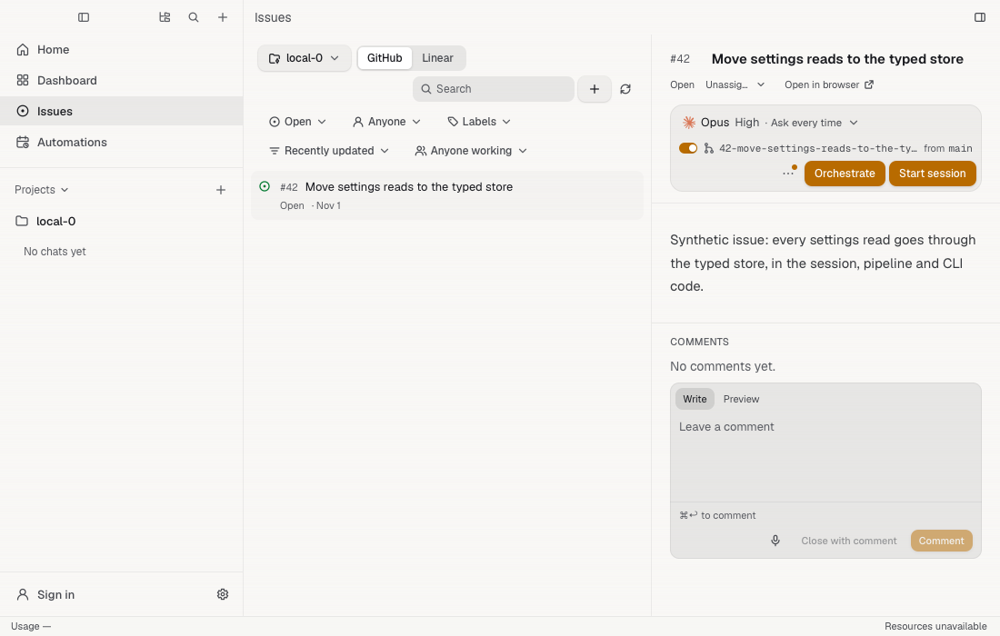 | 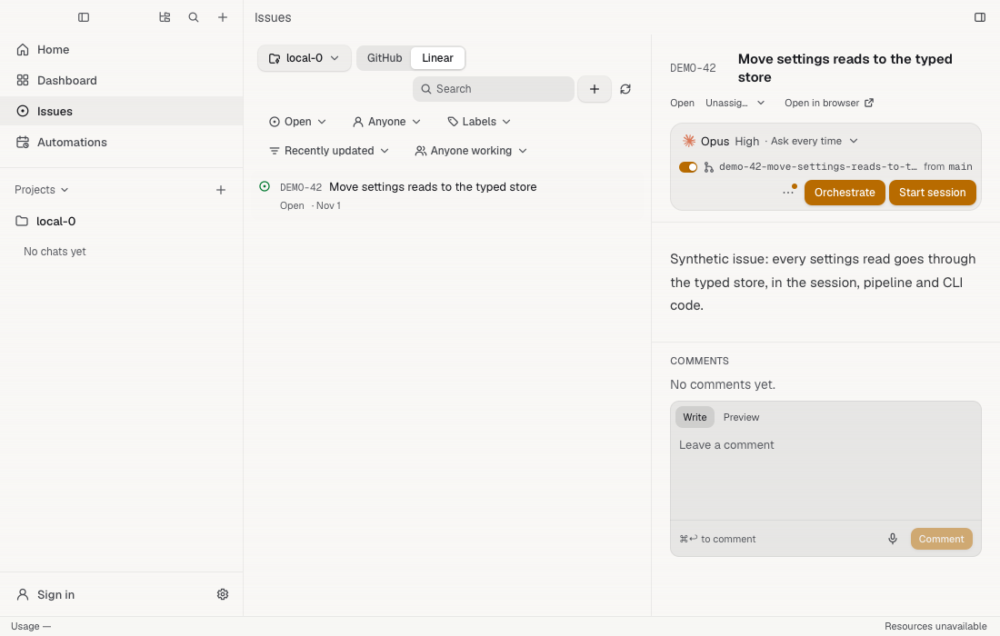 |
| Switch on, dark | 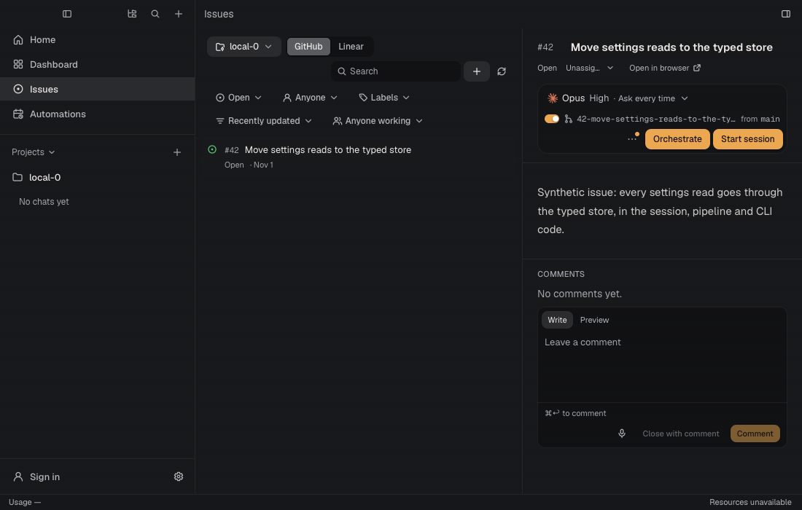 | 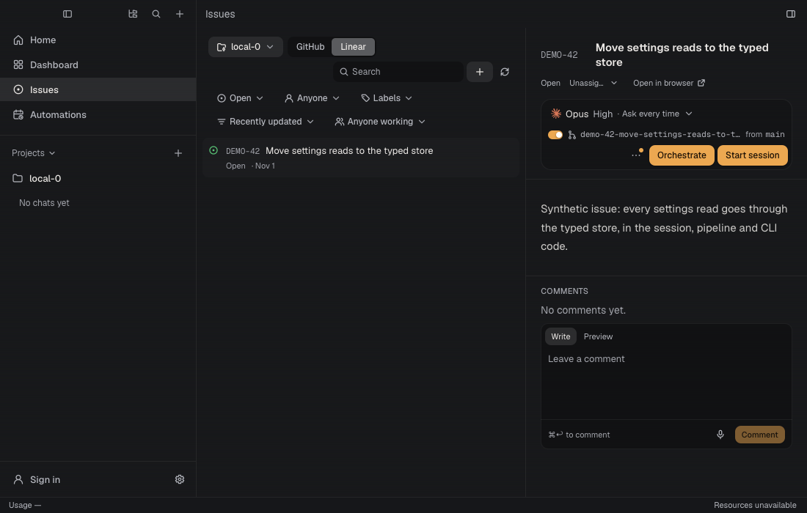 |
| Switch off | 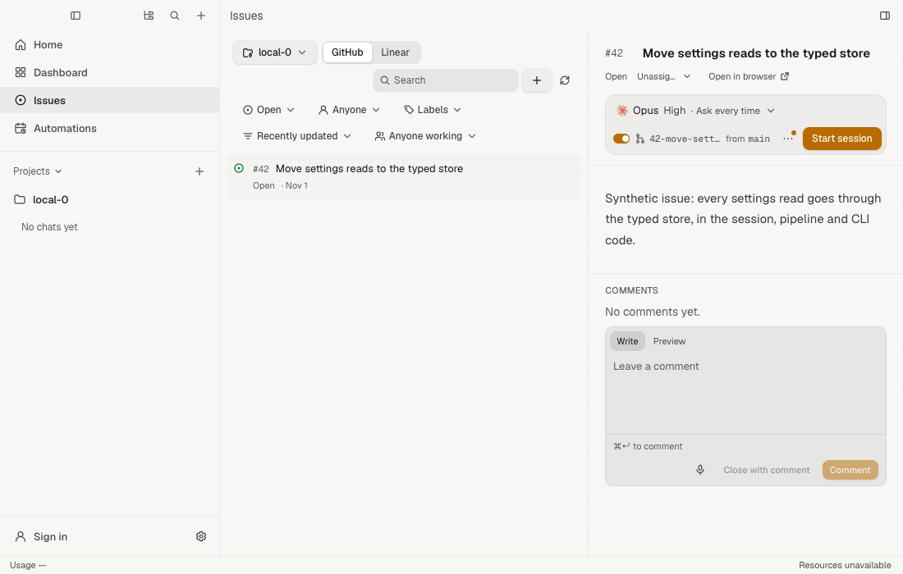 | 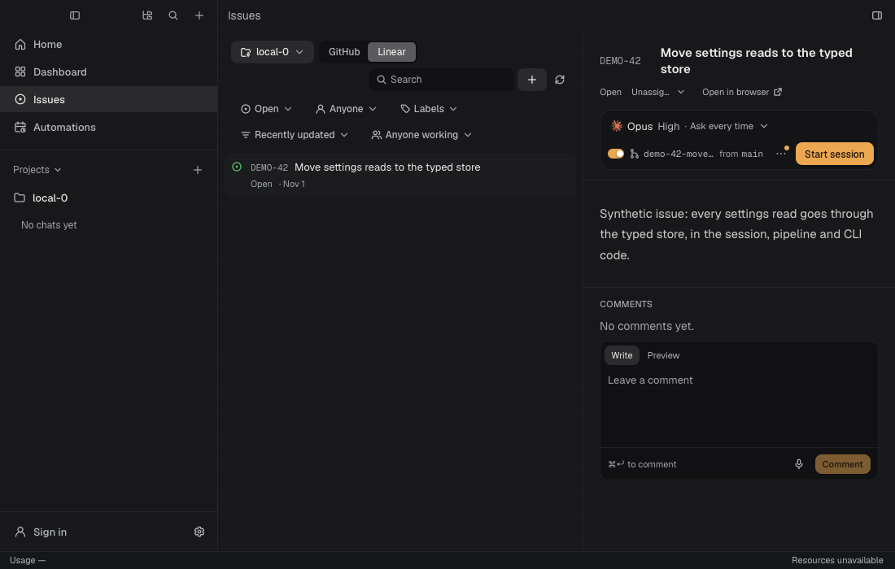 |

Narrow pane, switch on:

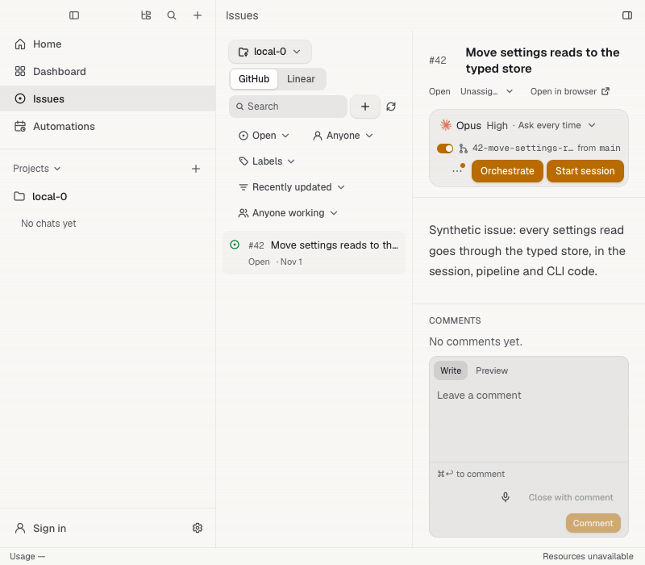

## The session Orchestrate starts

It opens on its Run tab. The project here asks for no approval, but the session was
started with Orchestrate, so the Run tab says a run waits for approval.

| Light | Dark |
| --- | --- |
| 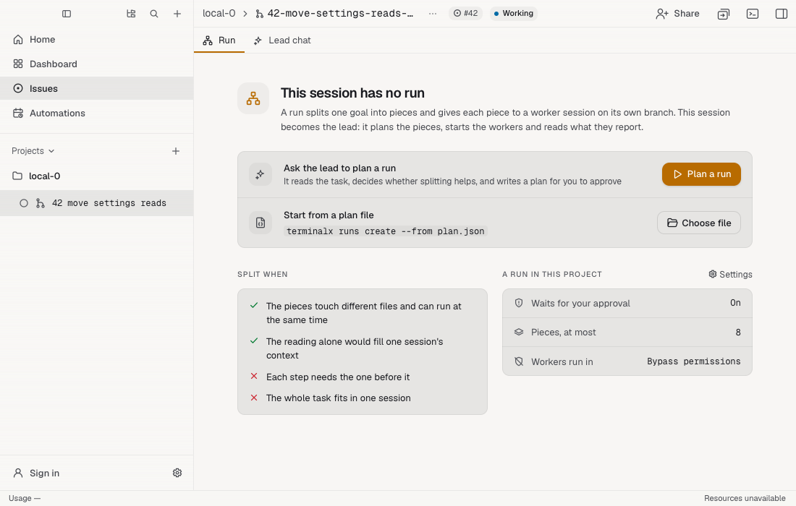 | 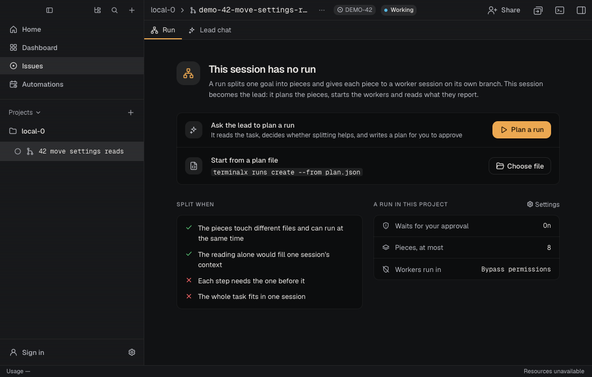 |

## Sidebar

"Move settings reads to the typed store" leads a run: the lead glyph, and folded,
pieces done out of total. "Try both parser rewrites" only started the two sessions
under it: its own status mark, the quieter fork mark ("Started these sessions"),
and no run summary.

| | Light | Dark |
| --- | --- | --- |
| Open | 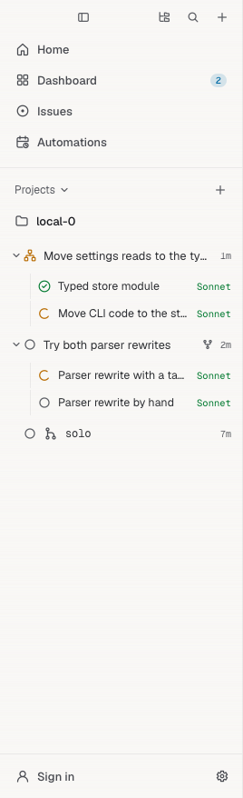 | 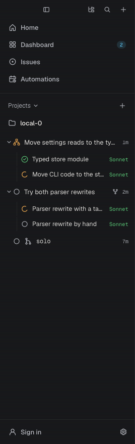 |
| Folded | 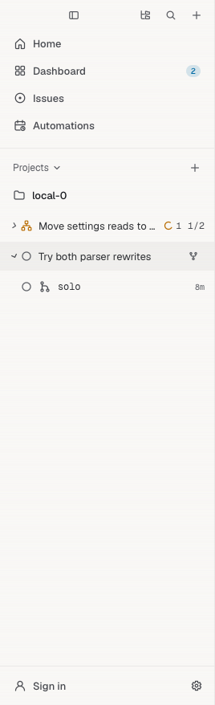 | 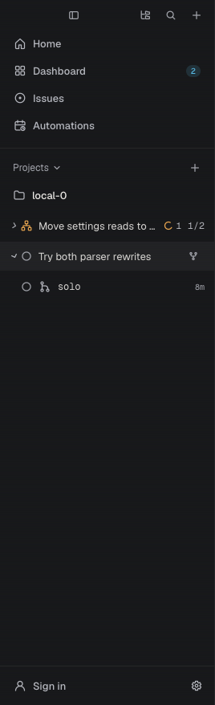 |
