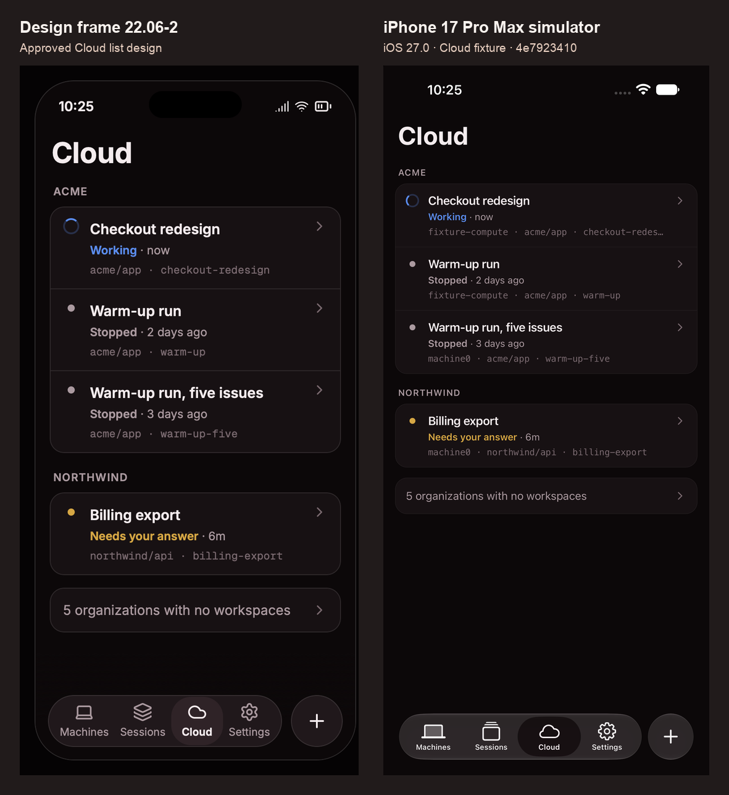

# PRO-456 Cloud list simulator evidence

## Acceptance decision

For #1206, the owner waived publication of the physical-iPhone capture and approved the labeled simulator comparison as the publication evidence alongside frame 22.06-2. [Owner decision on #1206](https://github.com/terminalx-ai/terminalx/issues/1206#issuecomment-7011674879).

The original physical iPhone 17 Pro Max check remains an author-reported observation. [PR #1186](https://github.com/terminalx-ai/terminalx/pull/1186).

## Verification

The Release simulator build used TerminalX source `4e792341097ab6ef9b04b26cc526aeb9c09800b8` on an iPhone 17 Pro Max simulator running iOS 27.0. The checked-in [Cloud fixture](../../../mobile/scripts/phone-fixture/README.md) supplies synthetic organizations and workspaces to the app's Cloud catalog.

- ACME showed the stopped `Warm-up run` workspace from `fixture-compute`. Tapping it opened the correct stopped workspace and displayed its saved conversation.
- The footer showed five empty organizations. Expanding it listed Globex, Initech, Umbrella, Hooli, and Vandelay. ACME and Northwind appeared in the workspace list.
- The two PRO-456 catalog regression tests passed. They exercise a synthetic Agent37 Demo response and verify one workspace row, exclusion from the empty-organizations footer, and a footer count of ten.

The left panel shows design frame 22.06-2 from the [original design comparison in PR #1015](https://github.com/terminalx-ai/terminalx/pull/1015). The right panel shows the simulator's Cloud list in the Ember theme.

