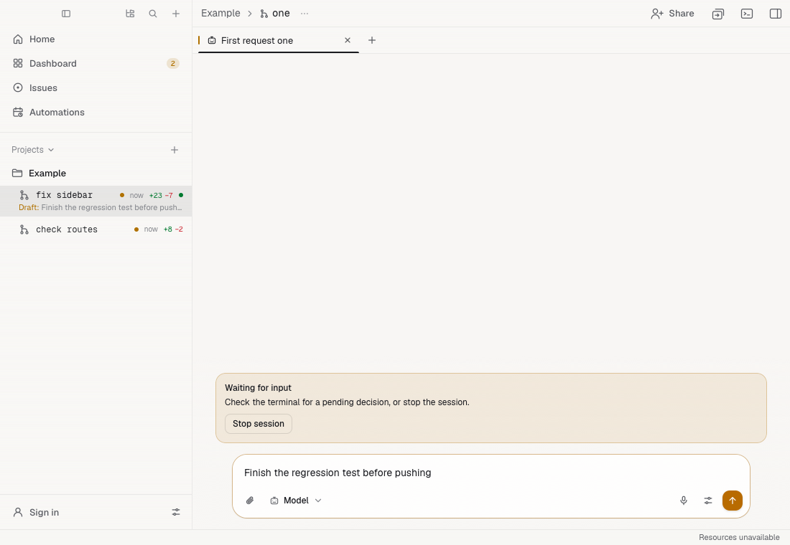
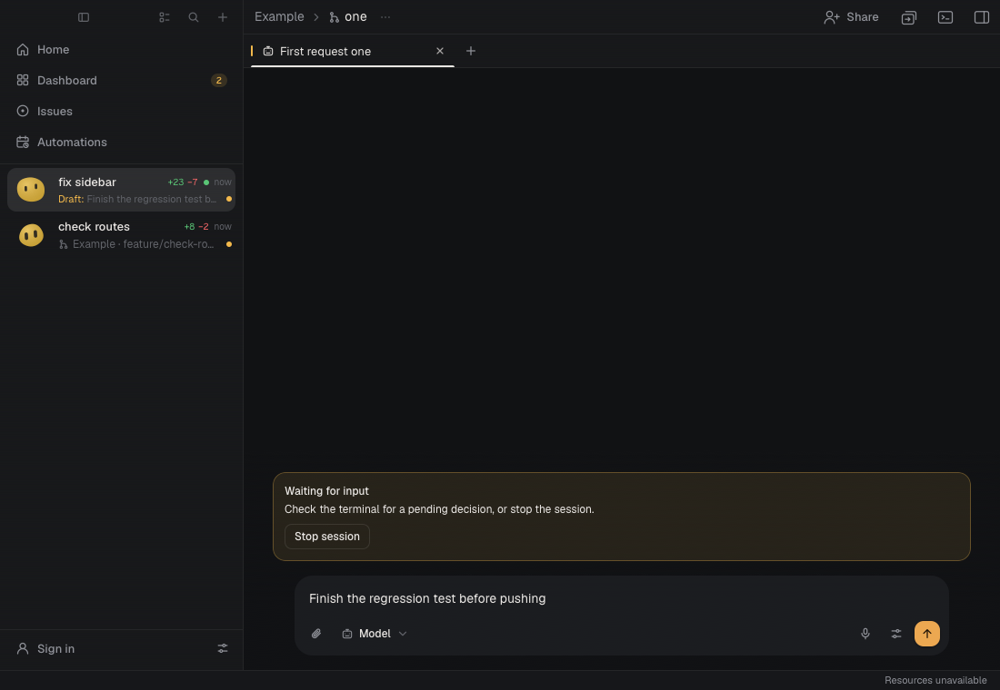

# PRO-179 verification

The row extras use the existing workspace totals and global turn-status refresh, shell activity, drafts, and dashboard Needs you ordering. Draft previews reflect the current window's in-memory unsent prompts; this change does not add persistence across restarts or windows. A bounded `lsof` probe, cached for ten seconds, attributes listening servers to their working checkout (including detached servers). Polls use live session directories from the window's existing store, exclude archived/removed sessions, and cache canonical paths with the probe. They do not reload the session index or message-activity files. Unix hosts need `lsof`; hosts without it still show running commands. Sessions sharing a checkout share its port indicator and line counts.

Unread reminders are stored as `markedUnread` on each Rust tab. The paired-phone summaries expose the same flag. Opening the tab clears it without starting its agent or changing its activity time; a reminder set during an existing visit remains until the next visit. Automatic archiving respects it.

## Checks

- Desktop and mobile TypeScript checks.
- Focused Vitest files with `--maxWorkers=1`; the full suite is left to CI.
- `CARGO_BUILD_JOBS=2 cargo clippy --all-targets -- -D warnings`, with `SDKROOT` and `CMAKE_OSX_SYSROOT` set to the installed Xcode 26.5 SDK to avoid the host's CommandLineTools SDK/linker mismatch.
- Rust tests added for stored flags, restart, phone reads, unchanged activity order, archive protection, and port attribution. `cargo test` is left to CI as requested.
- `scripts/webkit/sidebar-extras.mjs` ran headlessly in the local `terminalx-cua-macos` Lume VM against a production build and synthetic native bridge. Both layouts passed in light and dark mode: counts, open-port dot, menu R accelerator, persisted unread state, opening to clear it, draft restoration, next-attention cycling, sidebar overflow, and the Archive shortcut tooltip. The host GUI was not used.

## Dependency scope

PRO-174 / #824 is on main. PRO-159 / #821, PRO-164 / #811, and PRO-169 / #810 were still open when checked. PRO-232's message/tab actions are not on main either. This change does not duplicate their status, ordering, or tab-menu work. Follow-up: add PR-title precedence once #821 supplies shared row PR data. Isolated workspace rows use a readable branch name and then the first request, preserving explicit names; chats sharing a checkout and chats in the project's root keep distinct conversation titles. PRO-232 can use `agent.setUnread(sessionId, tabId, unread)` for its tab menu.

